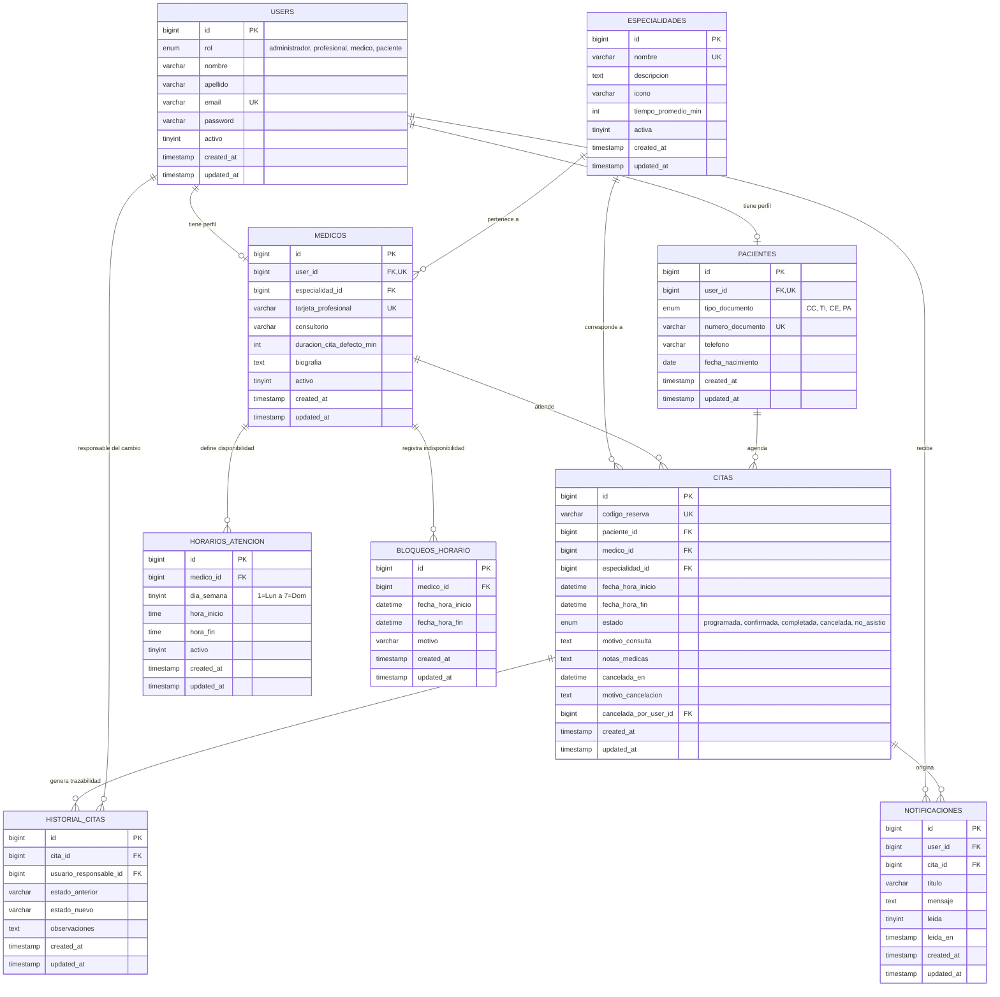

# Diccionario de Datos — Sistema MediTurno
**Versión:** 1.0.0 — Sprint 2  
**Motor de Base de Datos:** MySQL 8.0 / MariaDB 10.4  
**Collation:** `utf8mb4_unicode_ci`  
**Base de Datos:** `mediturno`

---

## 1. Diagrama Entidad-Relación (ERD)

---

## 2. Especificación Detallada de Tablas

### 2.1. Tabla: `users`
Almacena las credenciales de acceso, perfil del sistema y estado de activación de todas las personas que interactúan con MediTurno.

| Campo | Tipo | Nulo | Por Defecto | Llave | Descripción |
| :--- | :--- | :---: | :---: | :---: | :--- |
| `id` | `BIGINT UNSIGNED` | No | AUTO_INCREMENT | **PK** | Identificador único del usuario. |
| `rol` | `VARCHAR(30)` | No | `'paciente'` | — | Rol asignado (`administrador`, `admin`, `profesional`, `medico`, `paciente`). |
| `nombre` | `VARCHAR(100)` | No | — | — | Nombres de pila del usuario. |
| `apellido` | `VARCHAR(100)` | No | — | — | Apellidos del usuario. |
| `name` | `VARCHAR(200)` | No | — | — | Nombre completo conciliado (compatibilidad Laravel). |
| `email` | `VARCHAR(150)` | No | — | **UK** | Correo electrónico institucional o personal (login único). |
| `email_verified_at` | `TIMESTAMP` | Sí | `NULL` | — | Fecha y hora de verificación de correo. |
| `password` | `VARCHAR(255)` | No | — | — | Hash de contraseña cifrada con Bcrypt (mínimo 12 rondas). |
| `activo` | `TINYINT(1)` | No | `1` | — | Estado de la cuenta (`1`: Activa, `0`: Inactiva/bloqueada). |
| `remember_token` | `VARCHAR(100)` | Sí | `NULL` | — | Token para persistencia de sesión "recordarme". |
| `created_at` | `TIMESTAMP` | Sí | `NULL` | — | Fecha y hora de registro. |
| `updated_at` | `TIMESTAMP` | Sí | `NULL` | — | Fecha y hora de última modificación. |

---

### 2.2. Tabla: `especialidades`
Catálogo de áreas médicas ofrecidas por la clínica. Controla la duración base y presentación de servicios.

| Campo | Tipo | Nulo | Por Defecto | Llave | Descripción |
| :--- | :--- | :---: | :---: | :---: | :--- |
| `id` | `BIGINT UNSIGNED` | No | AUTO_INCREMENT | **PK** | Identificador de la especialidad. |
| `nombre` | `VARCHAR(100)` | No | — | **UK** | Nombre único de la especialidad (ej. Cardiología, Pediatría). |
| `descripcion` | `VARCHAR(500)` | Sí | `NULL` | — | Resumen de los servicios y alcance de la especialidad. |
| `icono` | `VARCHAR(50)` | No | `'Stethoscope'` | — | Identificador del icono vectorial (Lucide React). |
| `tiempo_promedio_min` | `INT UNSIGNED` | No | `30` | — | Duración estimada de atención en minutos (15, 20, 30, 45, 60). |
| `activa` | `TINYINT(1)` | No | `1` | — | Estado operativo (`1`: Disponible para agendar, `0`: En pausa). |
| `created_at` | `TIMESTAMP` | Sí | `NULL` | — | Fecha de creación del registro. |
| `updated_at` | `TIMESTAMP` | Sí | `NULL` | — | Fecha de última edición. |

---

### 2.3. Tabla: `pacientes`
Información sociodemográfica e identificación legal de los pacientes en Colombia.

| Campo | Tipo | Nulo | Por Defecto | Llave | Descripción |
| :--- | :--- | :---: | :---: | :---: | :--- |
| `id` | `BIGINT UNSIGNED` | No | AUTO_INCREMENT | **PK** | Identificador interno de registro del paciente. |
| `user_id` | `BIGINT UNSIGNED` | No | — | **FK, UK** | Relación 1:1 hacia `users.id` (`ON DELETE CASCADE`). |
| `tipo_documento` | `ENUM('CC','TI','CE','PA')` | No | `'CC'` | — | Tipo de documento de identidad oficial. |
| `numero_documento` | `VARCHAR(20)` | No | — | **UK** | Número de documento único (sin puntos ni guiones). |
| `telefono` | `VARCHAR(20)` | No | — | — | Número de contacto telefónico/móvil. |
| `fecha_nacimiento` | `DATE` | No | — | — | Fecha de nacimiento para cálculo de edad clínica. |
| `created_at` | `TIMESTAMP` | Sí | `NULL` | — | Fecha de registro del paciente. |
| `updated_at` | `TIMESTAMP` | Sí | `NULL` | — | Fecha de actualización de datos. |

---

### 2.4. Tabla: `medicos`
Información profesional, legal y locativa de los profesionales de la salud.

| Campo | Tipo | Nulo | Por Defecto | Llave | Descripción |
| :--- | :--- | :---: | :---: | :---: | :--- |
| `id` | `BIGINT UNSIGNED` | No | AUTO_INCREMENT | **PK** | Identificador interno del médico. |
| `user_id` | `BIGINT UNSIGNED` | No | — | **FK, UK** | Relación 1:1 hacia `users.id` (`ON DELETE CASCADE`). |
| `especialidad_id` | `BIGINT UNSIGNED` | No | — | **FK** | Especialidad médica ejercida (`especialidades.id`). |
| `tarjeta_profesional` | `VARCHAR(50)` | No | — | **UK** | Registro médico legal único ante el Ministerio de Salud. |
| `consultorio` | `VARCHAR(100)` | No | — | — | Ubicación física de atención (ej. Consultorio 302, Torre B). |
| `duracion_cita_defecto_min` | `INT UNSIGNED` | No | `30` | — | Duración predeterminada de citas en su agenda. |
| `biografia` | `TEXT` | Sí | `NULL` | — | Reseña académica y perfil profesional del médico. |
| `activo` | `TINYINT(1)` | No | `1` | — | Disponibilidad asistencial (`1`: Atendiendo, `0`: Inactivo). |
| `created_at` | `TIMESTAMP` | Sí | `NULL` | — | Fecha de vinculación. |
| `updated_at` | `TIMESTAMP` | Sí | `NULL` | — | Fecha de actualización. |

---

### 2.5. Tabla: `horarios_atencion`
Definición de las franjas horarias semanales en que un médico atiende pacientes.

| Campo | Tipo | Nulo | Por Defecto | Llave | Descripción |
| :--- | :--- | :---: | :---: | :---: | :--- |
| `id` | `BIGINT UNSIGNED` | No | AUTO_INCREMENT | **PK** | Identificador de la franja horaria. |
| `medico_id` | `BIGINT UNSIGNED` | No | — | **FK** | Profesional médico titular (`medicos.id`, `ON DELETE CASCADE`). |
| `dia_semana` | `TINYINT UNSIGNED` | No | — | — | Día de la semana (`1`: Lunes, `2`: Martes, ..., `7`: Domingo). |
| `hora_inicio` | `TIME` | No | — | — | Hora militar de apertura de atención (ej. `08:00:00`). |
| `hora_fin` | `TIME` | No | — | — | Hora militar de cierre de atención (ej. `12:00:00`). |
| `activo` | `TINYINT(1)` | No | `1` | — | Estado de la franja horaria (`1`: Vigente, `0`: Suspendida). |
| `created_at` | `TIMESTAMP` | Sí | `NULL` | — | Fecha de alta de horario. |
| `updated_at` | `TIMESTAMP` | Sí | `NULL` | — | Fecha de modificación. |

---

### 2.6. Tabla: `bloqueos_horario`
Excepciones y suspensiones de agenda médica (vacaciones, capacitaciones, incapacidades).

| Campo | Tipo | Nulo | Por Defecto | Llave | Descripción |
| :--- | :--- | :---: | :---: | :---: | :--- |
| `id` | `BIGINT UNSIGNED` | No | AUTO_INCREMENT | **PK** | Identificador del bloqueo. |
| `medico_id` | `BIGINT UNSIGNED` | No | — | **FK** | Médico afectado (`medicos.id`, `ON DELETE CASCADE`). |
| `fecha_hora_inicio` | `DATETIME` | No | — | — | Inicio del periodo no disponible. |
| `fecha_hora_fin` | `DATETIME` | No | — | — | Fin del periodo no disponible. |
| `motivo` | `VARCHAR(255)` | No | — | — | Razón del bloqueo (ej. Congreso médico, Vacaciones). |
| `created_at` | `TIMESTAMP` | Sí | `NULL` | — | Registro de la novedad. |
| `updated_at` | `TIMESTAMP` | Sí | `NULL` | — | Modificación de la novedad. |

---

### 2.7. Tabla: `citas`
Entidad transaccional central que registra el agendamiento y ciclo de vida de la atención médica.

| Campo | Tipo | Nulo | Por Defecto | Llave | Descripción |
| :--- | :--- | :---: | :---: | :---: | :--- |
| `id` | `BIGINT UNSIGNED` | No | AUTO_INCREMENT | **PK** | Identificador primario de la cita médica. |
| `codigo_reserva` | `VARCHAR(20)` | No | — | **UK** | Código alfanumérico único para el paciente (ej. `MED-10928`). |
| `paciente_id` | `BIGINT UNSIGNED` | No | — | **FK** | Paciente que recibe la atención (`pacientes.id`). |
| `medico_id` | `BIGINT UNSIGNED` | No | — | **FK** | Profesional médico asignado (`medicos.id`). |
| `especialidad_id` | `BIGINT UNSIGNED` | No | — | **FK** | Especialidad clínica agendada (`especialidades.id`). |
| `fecha_hora_inicio` | `DATETIME` | No | — | **INDEX** | Fecha y hora exacta de inicio de la cita. |
| `fecha_hora_fin` | `DATETIME` | No | — | — | Fecha y hora de finalización prevista. |
| `estado` | `ENUM(...)` | No | `'programada'` | **INDEX** | `programada`, `confirmada`, `completada`, `cancelada`, `no_asistio`. |
| `motivo_consulta` | `TEXT` | Sí | `NULL` | — | Descripción inicial de síntomas provista por el paciente. |
| `notas_medicas` | `TEXT` | Sí | `NULL` | — | Observaciones clínicas del médico al atender. |
| `cancelada_en` | `DATETIME` | Sí | `NULL` | — | Momento exacto de anulación (si aplica). |
| `motivo_cancelacion` | `TEXT` | Sí | `NULL` | — | Justificación obligatoria para anular la cita. |
| `cancelada_por_user_id`| `BIGINT UNSIGNED`| Sí | `NULL` | **FK** | Usuario que ejecutó la cancelación (`users.id`). |
| `created_at` | `TIMESTAMP` | Sí | `NULL` | — | Fecha y hora de agendamiento. |
| `updated_at` | `TIMESTAMP` | Sí | `NULL` | — | Fecha y hora de última actualización. |

---

### 2.8. Tabla: `historial_citas`
Registro inmutable de auditoría para trazabilidad médica y cambios de estado.

| Campo | Tipo | Nulo | Por Defecto | Llave | Descripción |
| :--- | :--- | :---: | :---: | :---: | :--- |
| `id` | `BIGINT UNSIGNED` | No | AUTO_INCREMENT | **PK** | Identificador del evento de auditoría. |
| `cita_id` | `BIGINT UNSIGNED` | No | — | **FK** | Cita intervenida (`citas.id`, `ON DELETE CASCADE`). |
| `usuario_responsable_id`| `BIGINT UNSIGNED`| No | — | **FK** | Usuario autenticado que realizó el cambio (`users.id`). |
| `estado_anterior` | `VARCHAR(30)` | No | — | — | Estado previo de la cita médica. |
| `estado_nuevo` | `VARCHAR(30)` | No | — | — | Nuevo estado resultante. |
| `observaciones` | `TEXT` | Sí | `NULL` | — | Detalle explicativo de la transición. |
| `created_at` | `TIMESTAMP` | Sí | `NULL` | — | Marca de tiempo inmutable del evento. |
| `updated_at` | `TIMESTAMP` | Sí | `NULL` | — | Marca de tiempo. |

---

### 2.9. Tabla: `notificaciones`
Notificaciones internas enviadas a pacientes, médicos y administradores.

| Campo | Tipo | Nulo | Por Defecto | Llave | Descripción |
| :--- | :--- | :---: | :---: | :---: | :--- |
| `id` | `BIGINT UNSIGNED` | No | AUTO_INCREMENT | **PK** | Identificador de la notificación. |
| `user_id` | `BIGINT UNSIGNED` | No | — | **FK** | Usuario destinatario (`users.id`, `ON DELETE CASCADE`). |
| `cita_id` | `BIGINT UNSIGNED` | Sí | `NULL` | **FK** | Cita relacionada (`citas.id`, `ON DELETE SET NULL`). |
| `titulo` | `VARCHAR(150)` | No | — | — | Encabezado descriptivo de la notificación. |
| `mensaje` | `TEXT` | No | — | — | Contenido detallado del aviso. |
| `leida` | `TINYINT(1)` | No | `0` | — | Indicador de lectura (`0`: No leída, `1`: Leída). |
| `leida_en` | `TIMESTAMP` | Sí | `NULL` | — | Momento en que el usuario abrió o leyó la notificación. |
| `created_at` | `TIMESTAMP` | Sí | `NULL` | — | Fecha y hora de emisión del mensaje. |
| `updated_at` | `TIMESTAMP` | Sí | `NULL` | — | Fecha y hora de actualización. |

---

## 3. Tablas de Infraestructura y Soporte Laravel

1. **`sessions`:** Gestiona el almacenamiento de sesiones web en base de datos (`SESSION_DRIVER=database`), transportadas a través de cookies seguras `HttpOnly` y `SameSite=Lax`.
2. **`cache` y `cache_locks`:** Soporta el sistema de Rate Limiting para mitigar ataques de fuerza bruta en los inicios de sesión.
3. **`jobs` y `failed_jobs`:** Cola de tareas asíncronas para procesamiento de notificaciones y mantenimiento en background.
4. **`migrations`:** Historial de control de versiones de la estructura de base de datos de Laravel.
