# ESPECIFICACIÓN DE REQUISITOS DE SOFTWARE (SRS)

**PROYECTO:** MEDITURNO - SISTEMA DE GESTIÓN Y PROGRAMACIÓN DE CITAS MÉDICAS  
**CENTRO DE LA INDUSTRIA, LA EMPRESA Y LOS SERVICIOS – REGIONAL HUILA**  
**TECNÓLOGO EN ANÁLISIS Y DESARROLLO DE SOFTWARE**  
**FICHA:** 3413988  
**APRENDIZ:** JUAN FERNANDO BAHAMÓN RAMÍREZ  
**INSTRUCTOR:** JAVIER HUMBERTO PINTO DIAZ  
**NEIVA, HUILA**  
**11 de noviembre de 2026**

---

## Control de Versiones del Documento

| Versión | Fecha | Autor | Descripción del Cambio | Rama / Commit |
| :---: | :---: | :--- | :--- | :---: |
| **v1.0.0** | 11/11/2026 | Juan Fernando Bahamón Ramírez | Versión inicial completa del SRS de **MediTurno**, alineada con el boceto funcional del sitio web en Laravel 11, MySQL 8.0, React 18 y Tailwind CSS (módulos de Autenticación RBAC, Pacientes, Profesionales, Especialidades, Agendas/Calendarios, Citas transaccionales, Reprogramación, Cancelación, Reportes CSV y Plan de Pruebas CP-01 a CP-14). | `main` |
| **v1.0.1** | 11/11/2026 | Juan Fernando Bahamón Ramírez | Actualización del nombre del instructor evaluador en portada y sección 1.6 (Javier Humberto Pinto Díaz). | `main` |
| **v1.1.0** | 13/11/2026 | Juan Fernando Bahamón Ramírez | Implementación de pantalla Gatekeeper inicial obligatoria (aislamiento total sin sesión previa), validación de perfil en login, mitigación de fuerza bruta con Rate Limiting (bloqueo temporal a 5 intentos fallidos, HTTP 429 con `Retry-After`), control de acceso estricto tanto en backend (`EnsureUserHasRole`) como en frontend (`ProtectedRoute`), y suite automatizada de pruebas de seguridad (`SeguridadAutenticacionTest`). | `DEV` |
| **v1.2.0** | 13/11/2026 | Juan Fernando Bahamón Ramírez | Simplificación y consolidación de la arquitectura de perfiles a la tríada estándar del MVP: **Administrador**, **Profesionales Médicos** y **Pacientes**. Eliminación de los roles auxiliares de 'agendas' y 'citas' en favor del panel administrativo integral (`/admin/dashboard`). Actualización de la pantalla Gatekeeper con selector de 3 perfiles institucionales y actualización de la suite de pruebas automatizadas. | `DEV` |

---

## Contenido

1. [Introducción](#1-introducción)
   - 1.1. [Planteamiento del problema](#11-planteamiento-del-problema)
   - 1.2. [Propósito](#12-propósito)
   - 1.3. [Justificación](#13-justificación)
   - 1.3.1. [Vigilancia tecnológica y referentes de mercado](#131-vigilancia-tecnológica-y-referentes-de-mercado)
   - 1.4. [Objetivo general](#14-objetivo-general)
   - 1.4.1. [Objetivos específicos](#141-objetivos-específicos)
   - 1.5. [Alcances](#15-alcances)
   - 1.6. [Personal Involucrado](#16-personal-involucrado)
   - 1.6.1. [Roles y responsabilidades del equipo](#161-roles-y-responsabilidades-del-equipo)
   - 1.7. [Definiciones, acrónimos y abreviaturas](#17-definiciones-acrónimos-y-abreviaturas)
   - 1.8. [Referencias](#18-referencias)
   - 1.9. [Resumen](#19-resumen)
2. [Descripción general](#2-descripción-general)
   - 2.1. [Perspectiva del producto](#21-perspectiva-del-producto)
   - 2.2. [Características de los usuarios](#22-características-de-los-usuarios)
   - 2.3. [Restricciones](#23-restricciones)
   - 2.4. [Suposiciones y dependencias](#24-suposiciones-y-dependencias)
3. [Requisitos específicos](#3-requisitos-específicos)
   - 3.1. [Requisitos comunes de las interfaces](#31-requisitos-comunes-de-las-interfaces)
   - 3.2. [Historias de Usuario (HU-01 a HU-26)](#32-historias-de-usuario)
   - 3.2.1. [Diagramas de Casos de Uso (CU-01 a CU-26)](#321-diagramas-de-casos-de-uso)
   - 3.3. [Requerimientos Funcionales (RF1 a RF26)](#33-requerimientos-funcionales)
   - 3.4. [Requerimientos no Funcionales (RNF-01 a RNF-12)](#34-requerimientos-no-funcionales)
4. [Plan de Pruebas y Matriz de Trazabilidad](#4-plan-de-pruebas-y-matriz-de-trazabilidad)

---

## 1. Introducción

El presente documento contiene la Especificación de Requisitos de Software (SRS) del proyecto **MediTurno**, un sistema web integral de gestión y programación de citas médicas orientado a apoyar la administración de pacientes, profesionales de la salud, especialidades médicas, agendas de disponibilidad y citas en pequeños consultorios y centros médicos. El documento tiene como propósito describir de forma clara, verificable y trazable las funcionalidades, reglas de negocio, restricciones y atributos de calidad que deberá cumplir el sistema, sirviendo como base formal para el diseño, el desarrollo, las pruebas y la validación del producto por parte del aprendiz, el instructor y los interesados del proyecto.

La solución contempla la centralización de procesos como el registro y autenticación segura de usuarios por rol, la consulta pública del directorio médico y especialidades, el cálculo dinámico de calendarios y franjas horarias disponibles, la reserva atómica de citas protegida contra duplicidades, la cancelación y reprogramación bajo reglas de tiempo mínimo, el seguimiento diario de la agenda médica, la generación de reportes administrativos y la emisión de notificaciones internas y confirmación dinámica hacia WhatsApp Web. El planteamiento detallado de la problemática que motiva este proyecto se desarrolla en la sección 1.1.

### 1.1. Planteamiento del problema

En muchos consultorios médicos, centros de atención ambulatoria y pequeñas instituciones prestadoras de servicios de salud en Colombia, la programación y administración de citas médicas todavía se realiza mediante canales no estructurados como llamadas telefónicas, mensajes de WhatsApp, agendas físicas en papel o registros manuales en hojas de cálculo.

Esta situación operativa genera múltiples inconvenientes tanto para los pacientes como para el personal administrativo y médico:
- **Dificultad para consultar disponibilidad:** Los pacientes no pueden verificar en tiempo real qué horarios o especialistas se encuentran libres sin comunicarse telefónicamente o esperar respuesta por mensajería.
- **Duplicidad y solapamiento de citas:** El registro manual en agendas físicas o archivos dispersos propicia que dos pacientes queden agendados en la misma franja horaria con el mismo profesional.
- **Pérdida o inconsistencia de información:** Los datos de contacto, documento de identidad y motivo de consulta pueden quedar incompletos o extraviarse entre conversaciones de chat y planillas sueltas.
- **Demoras en la asignación, cancelación y reprogramación:** Cualquier cambio de horario requiere intervención manual del personal de recepción, lo que ralentiza la liberación de turnos cancelados y provoca horarios muertos.
- **Falta de trazabilidad y seguimiento de estado:** Resulta complejo auditar quién canceló, reprogramó o atendió una cita, así como controlar inasistencias (`no_asistio`) o atenciones cerradas (`completada`).
- **Ausencia de reportes administrativos:** El centro médico carece de indicadores consolidados por fechas, especialistas o estados de cita para apoyar la toma de decisiones operativas.

A partir de esta situación se plantea la siguiente pregunta problema: **¿cómo diseñar e implementar una aplicación web que permita a MediTurno centralizar la administración de pacientes, profesionales médicos, especialidades y agendas de atención, facilitando la programación, consulta, cancelación, reprogramación y seguimiento de citas médicas sin duplicidades y bajo control de acceso por roles?**

### 1.2. Propósito

El presente documento SRS tiene como propósito especificar de manera clara, verificable y trazable los requisitos funcionales y no funcionales del **Sistema Web de Gestión y Programación de Citas Médicas MediTurno**. Su finalidad es servir como referencia oficial común entre el aprendiz desarrollador, el instructor evaluador y los usuarios piloto durante las fases de análisis, diseño, construcción, pruebas de calidad y sustentación, reduciendo ambigüedades y manteniendo sincronizado el alcance del sistema con cada nueva versión del sitio web.

El software permitirá modernizar la gestión administrativa de citas médicas mediante una plataforma web responsiva bajo arquitectura cliente-servidor (**Laravel 11 + MySQL 8.0** en el servidor y **React 18 + Tailwind CSS** en el cliente), integrando catálogo de especialidades, directorio de profesionales, motor de cálculo de calendarios y franjas disponibles, reserva transaccional anti-solapamiento, autogestión de cancelaciones/reprogramaciones, agenda clínica diaria del profesional, bandeja de notificaciones y reportes administrativos. El cálculo de calendarios y disponibilidad se realiza mediante reglas determinísticas sobre jornadas semanales, bloqueos y citas activas —no mediante modelos clínicos ni diagnóstico médico automatizado—, en coherencia con el alcance definido en la sección 1.5.

### 1.3. Justificación

El proyecto se justifica en la necesidad de dotar a pequeños consultorios y centros de salud de una herramienta tecnológica accesible, segura y organizada que elimine los cuellos de botella del agendamiento manual. La digitalización de los servicios de atención al ciudadano y al paciente permite reducir tiempos de espera, disminuir el ausentismo mediante confirmaciones claras y aprovechar al máximo la capacidad instalada de cada profesional de la salud.

Según el Departamento Administrativo Nacional de Estadística (**DANE**, 2023), la cobertura de acceso a internet en hogares colombianos supera el 70%, y el uso de servicios digitales desde teléfonos inteligentes continúa en ascenso año tras año. Asimismo, los lineamientos nacionales de transformación digital del Ministerio de Tecnologías de la Información y las Comunicaciones (**MinTIC**) y la **Ley 1581 de 2012** sobre protección de datos personales establecen la importancia de gestionar la información sensible de los ciudadanos mediante sistemas seguros, con control de acceso y trazabilidad.

En el plano formativo (SENA — Tecnólogo en Análisis y Desarrollo de Software, Ficha 3413988), **MediTurno** permite aplicar de forma integrada competencias clave de análisis de requerimientos, modelado relacional en MySQL, desarrollo backend con Laravel bajo arquitectura MVC y API REST, diseño de interfaces responsivas centradas en el usuario, seguridad de sesiones con cookies `HttpOnly`, pruebas automatizadas con PHPUnit y control de versiones en GitHub con flujo por ramas (`main`, `QA`, `DEV`).

#### 1.3.1 Vigilancia tecnológica y referentes de mercado

Como parte del análisis previo al diseño del sistema, se realizó una revisión comparativa de referentes utilizados actualmente para la gestión de citas médicas y agendas:

| Referente | Tipo de solución | Aporte identificado | Limitación observada |
| :--- | :--- | :--- | :--- |
| **Agendas en papel / WhatsApp / Excel** | Gestión manual tradicional | Costo cero de entrada y comunicación directa conocida | Alta tasa de solapamientos, sin validación de 2 horas, sin auditoría ni reportes |
| **Directorios médicos comerciales (ej. Doctoralia)** | Marketplace multi-clínica de terceros | Visibilidad en buscadores y recordatorios básicos | Costos de suscripción elevados, dependencia de terceros y baja personalización administrativa |
| **Software clínico hospitalario (HIS/ERP)** | Suite integral de salud empresarial | Cobertura de historia clínica, facturación y RIPS | Complejidad excesiva y costos inviables para consultorios pequeños en etapa MVP |
| **Formularios web genéricos (Google Forms / Calendly)** | Agendamiento genérico por enlace | Facilidad para recolectar solicitudes de horario | No integran roles (Paciente/Médico/Admin), tarjetas profesionales, especialidades ni reglas de negocio médicas |

De esta comparación se concluye que ninguna de las alternativas gratuitas o genéricas analizadas integra en una sola solución ligera: directorio verificado con tarjeta profesional, cálculo de franjas por especialidad, bloqueo transaccional en MySQL contra reservas simultáneas, regla de anticipación de 2 horas, agenda diaria inmutable del médico y reportes administrativos por rol. Esto sustenta la pertinencia de construir **MediTurno**.

### 1.4. Objetivo general

Diseñar e implementar una aplicación web denominada **MediTurno** bajo arquitectura cliente-servidor (Laravel + MySQL), que centralice la administración de pacientes, profesionales de la salud, especialidades y agendas de disponibilidad, facilitando la reserva, consulta, cancelación, reprogramación y seguimiento de citas médicas sin duplicidades y con reportes administrativos para el centro de salud.

#### 1.4.1. Objetivos específicos

1. Analizar los requerimientos funcionales, no funcionales y reglas de negocio necesarios para el agendamiento médico sin conflictos.
2. Diseñar una base de datos relacional normalizada en MySQL que almacene usuarios, pacientes, profesionales, especialidades, horarios, bloqueos, citas, historial de auditoría y notificaciones.
3. Implementar un módulo de autenticación segura y control de acceso basado en roles (RBAC) para **Administrador**, **Profesional Médico** y **Paciente**.
4. Desarrollar los módulos administrativos de gestión de **Pacientes**, **Profesionales**, **Especialidades** y **Horarios de Atención** evitando franjas superpuestas.
5. Construir un motor de generación de calendarios y cálculo dinámico de disponibilidad que descuente turnos pasados, bloqueos y citas activas.
6. Implementar el flujo transaccional de reserva, cancelación (con regla mínima de 2 horas) y reprogramación de citas, garantizando integridad ante concurrencia (`409 Conflict`).
7. Desarrollar la agenda diaria e historial del profesional médico con actualización de estados (`completada`, `no_asistio`) y trazabilidad permanente.
8. Implementar un panel administrativo con indicadores clave, reportes filtrables y exportación de datos en formato CSV.
9. Ejecutar pruebas funcionales, de integración y seguridad automatizadas con PHPUnit sobre MySQL (`CP-01` a `CP-19`) para validar el cumplimiento integral del sistema.

### 1.5. Alcances

Con el fin de garantizar claridad frente a las funcionalidades incluidas en el MVP y evitar contradicciones con los requisitos detallados, el alcance de **MediTurno** se clasifica en tres niveles:

#### Incluye (versión inicial MVP v1.2.0)
- Pantalla inicial Gatekeeper de acceso seguro obligatorio (`/` y `/login`) con selector interactivo de los tres (3) perfiles institucionales (**Pacientes**, **Profesionales Médicos**, **Administrador**), protección activa contra fuerza bruta (bloqueo temporal con HTTP `429 Too Many Requests` tras 5 intentos fallidos) y botones de auditoría demo de un solo clic.
- Registro autónomo de pacientes (`/registro`) con validación de documento y correo único bajo la Ley 1581 de 2012.
- Catálogo de especialidades médicas y directorio de profesionales disponible en el flujo autenticado de reserva de citas y en el panel administrativo.
- Gestión administrativa de especialidades médicas (crear, editar, activar/desactivar).
- Gestión administrativa de profesionales médicos (registrar, asociar especialidad, activar/desactivar) y configuración de horarios semanales sin superposición.
- Gestión administrativa de pacientes (registrar y listar con conteo de citas).
- Generación dinámica de calendarios hábiles y consulta de franjas horarias libres vs. ocupadas/bloqueadas.
- Reserva atómica de citas con código único (`MT-YYYYMM-XXXX`), prevención de duplicidades (`409 Conflict`) y voucher de confirmación con enlace dinámico a WhatsApp Web.
- Consulta de citas del paciente (programadas e historial), cancelación y reprogramación con validación estricta de mínimo 2 horas de anticipación.
- Agenda médica diaria e historial del profesional con transición a estados finales (`completada`, `no_asistio`) e inmutabilidad.
- Trazabilidad de cambios en `historial_citas` y bandeja interna de notificaciones (`notificaciones`).
- Dashboard administrativo con métricas globales, reportes filtrables (fecha, profesional, estado) y exportación CSV.

#### Opcional (sujeto a iteraciones posteriores Fase 2)
- Envío automático de correos electrónicos transaccionales (SMTP) y recordatorios programados.
- Recuperación de contraseña mediante código temporal por correo o SMS.
- Exportación de reportes en formato PDF nativo y Excel (`.xlsx`).
- Bloqueos de agenda (descansos, vacaciones, incapacidades) gestionables directamente desde la interfaz del médico o administrador.
- Carga de fotografía de perfil para los profesionales médicos.

#### No incluye (mejoras futuras / fuera de alcance clínico)
- Historias clínicas electrónicas (HCE), diagnósticos médicos o prescripción electrónica de medicamentos.
- Telemedicina o videoconsultas en tiempo real (WebRTC).
- Integración con sistemas hospitalarios externos, RIPS o plataformas de EPS.
- Pasarelas de pago electrónico automatizadas ni facturación electrónica DIAN.
- Aplicación móvil nativa para iOS o Android.
- Inteligencia artificial para diagnóstico o recomendaciones clínicas médicas.

> **Nota importante:** *MediTurno es un sistema administrativo de gestión y programación de citas médicas; no constituye una herramienta de diagnóstico ni de atención clínica.*

### 1.6. Personal Involucrado

| Nombre | Juan Fernando Bahamón Ramírez |
| :--- | :--- |
| **Rol** | Líder de proyecto y Desarrollador Full Stack |
| **Categoría profesional** | Aprendiz del Tecnólogo en Análisis y Desarrollo de Software (Ficha 3413988) |
| **Responsabilidad** | Análisis de requerimientos, diseño de base de datos MySQL, implementación del backend en Laravel, integración del frontend, ejecución de pruebas y documentación técnica SRS. |
| **Información de contacto** | JFBR34880458@soy.sena.edu.co |

| Nombre | Javier Humberto Pinto Díaz |
| :--- | :--- |
| **Rol** | Instructor / Evaluador Técnico |
| **Categoría profesional** | Instructor SENA — Centro de la Industria, la Empresa y los Servicios (Regional Huila) |
| **Responsabilidad** | Seguimiento metodológico, revisión de entregables, validación de criterios técnicos de Laravel/MySQL y evaluación final del proyecto. |

#### 1.6.1. Roles y responsabilidades del equipo

| Rol | Responsabilidad |
| :--- | :--- |
| **Product Owner** | Definir requerimientos del negocio, reglas de agendamiento y prioridades del MVP |
| **Administrador del sistema** | Validar procesos operativos, catálogos, horarios y reportes |
| **Desarrollador Backend** | Implementar modelos Eloquent, servicios de disponibilidad, transacciones y API REST en Laravel |
| **Desarrollador Frontend** | Implementar interfaces responsivas, formularios con validación y experiencia de usuario |
| **Diseñador UX/UI** | Definir paleta 60-30-10, identidad visual, flujos de reserva y estados de interfaz |
| **QA Tester** | Diseñar y ejecutar casos de prueba (`CP-01` a `CP-19`) en PHPUnit y pruebas manuales |

### 1.7. Definiciones, acrónimos y abreviaturas

#### 1.7.1. Definiciones

- **Sistema de gestión de citas médicas:** Aplicación web que centraliza el registro de pacientes, profesionales, horarios de atención y programación ordenada de turnos médicos.
- **Cita médica:** Reserva confirmada entre un paciente y un profesional de la salud en una especialidad, fecha y franja horaria determinada.
- **Slot / Franja horaria:** Intervalo discreto de tiempo (por ejemplo, 30 minutos) calculado dentro de la jornada laboral de un profesional para asignar una cita.
- **Agenda médica:** Conjunto de jornadas semanales configuradas para un profesional, junto con sus bloqueos y citas programadas.
- **Bloqueo de horario:** Excepción temporal en la agenda de un profesional (descanso, vacaciones, incapacidad o actividad administrativa) que inhabilita la reserva de citas en ese lapso.
- **Código de reserva:** Identificador alfanumérico único generado al confirmar una cita (formato `MT-YYYYMM-XXXX`).
- **Voucher de confirmación:** Comprobante visual emitido tras completar una reserva exitosa, con los detalles de la cita y acceso rápido para compartir por WhatsApp Web.
- **Cancelación extemporánea:** Intento de anular o reprogramar una cita cuando faltan menos de 2 horas para su inicio, bloqueado por regla de negocio (`RN-07` / `RN-13`).
- **Reprogramación:** Cambio controlado de fecha y hora de una cita activa hacia un nuevo horario disponible, conservando trazabilidad en el historial.
- **Tarjeta profesional:** Número oficial que acredita el ejercicio legal de un profesional de la salud.
- **Dashboard:** Panel visual con indicadores clave (total de pacientes, médicos activos, citas agendadas, atendidas y canceladas) para apoyar la gestión administrativa.

#### 1.7.2. Acrónimos

| Acrónimo | Descripción |
| :--- | :--- |
| **SRS** | Software Requirements Specification (Especificación de Requisitos de Software). |
| **MVP** | Minimum Viable Product (Producto Mínimo Viable). |
| **RBAC** | Role-Based Access Control (Control de Acceso Basado en Roles). |
| **API** | Application Programming Interface (Interfaz de Programación de Aplicaciones). |
| **REST** | Representational State Transfer (Transferencia de Estado Representacional). |
| **MVC** | Model View Controller (Modelo-Vista-Controlador). |
| **ORM** | Object-Relational Mapping (Mapeo Objeto-Relacional — Eloquent en Laravel). |
| **UX / UI** | User Experience / User Interface (Experiencia de Usuario / Interfaz de Usuario). |
| **HTML / CSS / JS** | Lenguajes base de la interfaz web (HyperText Markup Language, Cascading Style Sheets, JavaScript). |
| **PHP** | Hypertext Preprocessor (Lenguaje de programación backend ejecutado en Laravel). |
| **DB / SQL** | Data Base / Structured Query Language. |
| **CRUD** | Create, Read, Update, Delete (Crear, Consultar, Actualizar y Eliminar). |
| **ACID** | Atomicity, Consistency, Isolation, Durability (Propiedades de transacciones en MySQL). |
| **HTTP / HTTPS** | Hypertext Transfer Protocol (Secure). |
| **JSON** | JavaScript Object Notation. |
| **CSV** | Comma-Separated Values (Formato tabular de exportación de reportes). |
| **KPI** | Key Performance Indicator (Indicador Clave de Desempeño). |

#### 1.7.3. Abreviaturas

- **RF:** Requerimiento Funcional.
- **RNF:** Requerimiento No Funcional.
- **HU:** Historia de Usuario.
- **CU:** Caso de Uso.
- **RN:** Regla de Negocio.
- **CP:** Caso de Prueba.
- **TP:** Tarjeta Profesional.
- **CC / TI / CE / PA:** Cédula de Ciudadanía / Tarjeta de Identidad / Cédula de Extranjería / Pasaporte.
- **ej.:** Ejemplo.
- **máx. / mín.:** Máximo / Mínimo.

### 1.8. Referencias

- Congreso de Colombia. (2012). *Ley Estatutaria 1581 de 2012: Por la cual se dictan disposiciones generales para la protección de datos personales*.
- Presidencia de la República de Colombia. (2013). *Decreto 1377 de 2013: Reglamentación parcial de la Ley 1581 de 2012*.
- Departamento Administrativo Nacional de Estadística (DANE). (2023). *Indicadores básicos de tenencia y uso de TIC en hogares*. https://www.dane.gov.co/
- IEEE Computer Society. (1998). *IEEE Std 830-1998: IEEE Recommended Practice for Software Requirements Specifications*.
- Laravel LLC. (2024). *Laravel 11.x Official Documentation — Routing, Eloquent ORM, Validation, Testing & Database Transactions*. https://laravel.com/docs/11.x
- Oracle Corporation. (2024). *MySQL 8.0 Reference Manual — InnoDB Locking and Transactions*. https://dev.mysql.com/doc/refman/8.0/en/

### 1.9. Resumen

Este documento define los requisitos funcionales, no funcionales, historias de usuario, casos de uso, arquitectura e instrumentos de verificación del sistema web **MediTurno**, orientado a resolver la desorganización del agendamiento manual en consultorios médicos y centros de salud pequeños. Frente a los referentes analizados en la sección 1.3.1, MediTurno aporta una solución unificada y robusta que combina acceso seguro inicial mediante Gatekeeper con selección de 3 perfiles institucionales (**Pacientes**, **Profesionales Médicos**, **Administrador**), protección activa contra fuerza bruta, control de acceso estricto por roles (RBAC), generación dinámica de calendarios, prevención transaccional de citas duplicadas en MySQL, autogestión de cancelaciones/reprogramaciones y reportes administrativos.

---

## 2. Descripción general

**MediTurno** es una aplicación web multiusuario diseñada para digitalizar, centralizar y controlar el ciclo de vida completo de la programación de citas médicas. El sistema se organiza en módulos integrados que comparten una base de datos relacional centralizada en MySQL y operan bajo políticas estrictas de validación en servidor y autorización por roles.

### 2.1. Perspectiva del producto

El sistema sigue una arquitectura cliente-servidor en tres capas desacopladas:

1. **Capa de Presentación (Frontend):** Aplicación web responsiva SPA construida con React 18, Vite 5 y Tailwind CSS 3 (compilada y servida por Laravel en producción), siguiendo la regla cromática clínica 60-30-10 (`#F8FAFC` superficie neutra, `#0284C7` azul zafiro clínico y `#10B981` verde esmeralda para disponibilidad, confirmación y WhatsApp).
2. **Capa de Lógica de Negocio (Backend API REST):** Implementada en **Laravel 11 (PHP 8.2)** bajo patrón MVC + Capa de Servicios (`AgendaDisponibilidadService`), responsable de la autenticación por cookies `HttpOnly` cifradas, validación de formularios, reglas de negocio (`RN-01` a `RN-13`), control de concurrencia mediante transacciones pesimistas (`lockForUpdate()`) y generación de reportes.
3. **Capa de Datos (Persistencia):** Base de datos relacional **MySQL 8.0** con integridad referencial mediante llaves foráneas, restricciones de unicidad (`email`, `numero_documento`, `tarjeta_profesional`, `codigo_reserva`), índices compuestos de disponibilidad y tablas de auditoría (`historial_citas`, `notificaciones`).

### 2.2. Características de los usuarios y Perfiles Institucionales (v1.2.0)

A partir de la versión **v1.2.0**, el sistema consolida su arquitectura en torno a la tríada fundamental de usuarios del MVP clínico, manteniendo la política estricta de **Gatekeeper Inicial Obligatorio** (ningún contenido sensible, catálogo ni panel operativo es visible sin autenticación previa):

- **1. Perfil Pacientes (`paciente`):** Usuario final que autogestiona su salud. Puede registrarse, iniciar sesión validando su perfil, consultar disponibilidad de turnos, reservar citas médicas, consultar sus citas activas e histórico, cancelar o reprogramar citas con anticipación mínima de 2 horas y revisar sus notificaciones. Tiene estrictamente restringido el acceso a agendas de otros pacientes, agendas de profesionales médicos y paneles administrativos.
- **2. Perfil Profesionales Médicos (`profesional` / `medico`):** Personal asistencial de la salud. Accede de forma exclusiva a su agenda cronológica diaria (`/medico/agenda`), visualiza los pacientes asignados a sus turnos con su motivo de consulta y actualiza el estado clínico de la cita a `completada` o `no_asistio`. No tiene acceso a datos de otros profesionales ni a módulos administrativos.
- **3. Perfil Administrador (`administrador`):** Usuario directivo encargado de la gestión integral del centro médico. Dispone de un panel centralizado (`/admin/dashboard`) con pestañas para administración de profesionales (alta, especialidad, activación y configuración de horarios semanales sin solapamiento), especialidades médicas, registro y consulta de pacientes, y reportes operativos filtrados con exportación en CSV.

### 2.3. Restricciones

- El sistema debe funcionar en navegadores web modernos (Google Chrome, Mozilla Firefox, Microsoft Edge) en equipos de escritorio, tabletas y teléfonos móviles.
- La pila tecnológica obligatoria en servidor y persistencia es **Laravel (PHP >= 8.2)** y **MySQL (>= 8.0)**.
- La autenticación del cliente se transporta mediante cookies de sesión `HttpOnly` cifradas con `credentials: 'include'`, quedando prohibido almacenar tokens sensibles en `localStorage`.
- Por tratarse de un proyecto académico desarrollado en el marco del **SENA**, los datos cargados en pruebas y demostraciones deben ser exclusivamente ficticios, respetando los principios de privacidad de la **Ley 1581 de 2012**.
- El sistema no implementa diagnósticos médicos, historias clínicas electrónicas ni pasarelas de pago.

### 2.4. Suposiciones y dependencias

- Se asume que los usuarios cuentan con conexión a internet y un navegador web actualizado.
- Se asume que la sede médica dispone de los datos reales de sus especialidades, tarjetas profesionales de sus médicos y jornadas semanales de atención para su carga inicial por el administrador.
- En entorno local o de despliegue, el sistema depende de la disponibilidad del servicio de base de datos MySQL 8.0 y del entorno de ejecución PHP 8.2+.
- La funcionalidad de compartir resumen por WhatsApp Web depende de que el dispositivo del paciente cuente con acceso a `wa.me` o WhatsApp instalado.

---

## 3. Requisitos específicos

### 3.1. Requisitos comunes de las interfaces

Las interfaces del sistema mantienen coherencia visual mediante la regla cromática 60-30-10, tipografía legible (`Inter` / `Poppins`), retroalimentación inmediata en formularios (bordes rojos y mensajes descriptivos que se limpian al editar), estados de carga mediante `SkeletonLoader`, estados vacíos con llamado a la acción (`EmptyState`) y notificaciones flotantes (`Toast`) en la esquina superior derecha.

#### 3.1.1. Interfaces de usuario (v1.2.0)

- **Gatekeeper Inicial Obligatorio:** Pantalla de acceso único (`/` y `/login`). No permite la visualización de ningún contenido clínico, catálogo ni panel administrativo sin previa autenticación exitosa. Incorpora el selector interactivo de tres perfiles de usuario (**Pacientes**, **Profesionales**, **Administrador**) con descripción operativa, retroalimentación de bloqueo por fuerza bruta y pruebas de un clic. Formulario de registro de pacientes disponible en `/registro`.
- **Módulo Paciente:** Portal personal con reserva guiada de citas (`/paciente/reservar`), voucher digital de confirmación y panel de gestión de citas (`/paciente/citas`) con modales de cancelación y reprogramación.
- **Módulo Profesional Médico:** Agenda clínica diaria (`/medico/agenda`) con visualización de pacientes citados y registro de atención (`completada` o `no_asistio`).
- **Módulo Administrador:** Tablero integral de control (`/admin/dashboard`) con 5 tarjetas de KPIs y pestañas independientes para **Profesionales** (con modal de configuración de horarios y bloqueos), **Especialidades**, **Pacientes** y **Reportes y Citas** (con filtros y exportación CSV).

#### 3.1.2. Interfaces de hardware

El sistema opera en computadores portátiles o de escritorio, tabletas y teléfonos inteligentes con pantalla táctil o periféricos estándar (teclado y ratón) y conectividad de red.

#### 3.1.3. Interfaces de software

- **Motor de Base de Datos:** MySQL 8.0 (`mediturno` para operación y `mediturno_test` para pruebas automatizadas PHPUnit).
- **Framework Backend:** Laravel 11 sobre PHP 8.2.
- **Cliente Web:** React 18 + Vite 5 + Tailwind CSS 3 + Lucide React + React Router DOM v6.
- **Integración Externa Ligera:** Enlace dinámico hacia WhatsApp Web (`https://wa.me/...`) con texto URL-encoded del comprobante de reserva.

#### 3.1.4. Interfaces de comunicación

La comunicación entre cliente y servidor se realiza mediante peticiones HTTP/HTTPS RESTful en formato JSON (`/api/*`) con transporte de credenciales mediante cookies `HttpOnly` (`credentials: 'include'`), respondiendo con códigos de estado HTTP estándar (`200`, `201`, `400`, `401`, `403`, `404`, `409`, `422`, `429 Too Many Requests`).

### 3.2. Historias de Usuario

Cada historia de usuario (`HU`) corresponde de forma directa a un requerimiento funcional (`RF`) con el mismo número, garantizando trazabilidad 1 a 1 entre ambos elementos del documento.

| HU-01 │ RF1 – Registrar paciente en la plataforma | |
| :--- | :--- |
| **Descripción:** Como paciente quiero poder registrarme en la plataforma con mis datos personales para solicitar citas médicas según mi rol asignado. | |
| **Criterios de validación**<br>• Completar nombre, apellido, documento, teléfono, fecha de nacimiento, correo y contraseña.<br>• No permitir correos o números de documento duplicados.<br>• Validar aceptación de política de tratamiento de datos (Ley 1581 de 2012).<br>• Almacenar la contraseña cifrada mediante hashing y asignar rol `paciente`. | **Métricas**<br>Valor: Alto<br>Prioridad: Alta<br>Estimación: 5 pts |

| HU-02 │ RF2 – Iniciar sesión segura con selección de perfil institucional y protección contra fuerza bruta | |
| :--- | :--- |
| **Descripción:** Como usuario registrado quiero iniciar sesión seleccionando mi perfil institucional (**Pacientes**, **Profesionales Médicos** o **Administrador**) con correo y contraseña, de modo que el sistema valide mi perfil, prevenga ataques de fuerza bruta y me dirija únicamente a mi módulo autorizado. | |
| **Criterios de validación**<br>• Selección obligatoria de uno de los 3 perfiles institucionales en la pantalla Gatekeeper inicial.<br>• Verificación estricta de que la cuenta pertenezca al perfil seleccionado (rechazo con HTTP `403 Forbidden` si un paciente intenta ingresar como profesional o administrador, y viceversa).<br>• Credenciales válidas autentican mediante sesión segura en cookie `HttpOnly` y regeneran el token de sesión.<br>• Protección contra fuerza bruta: tras 5 intentos fallidos consecutivos se activa un bloqueo temporal de 60 segundos devolviendo código HTTP `429 Too Many Requests` y cabecera `Retry-After`.<br>• Redirección automática a la vista correspondiente: `/paciente/citas`, `/medico/agenda` o `/admin/dashboard`. | **Métricas**<br>Valor: Alto<br>Prioridad: Alta<br>Estimación: 5 pts |

| HU-03 │ RF3 – Cerrar sesión de forma segura | |
| :--- | :--- |
| **Descripción:** Como usuario autenticado quiero cerrar mi sesión desde la barra de navegación para proteger mi cuenta al finalizar el uso del sistema. | |
| **Criterios de validación**<br>• Invalidación de la sesión activa en Laravel (`Auth::logout` + `invalidate` + regeneración de token).<br>• Limpieza del estado de usuario en cliente.<br>• Redirección a la pantalla Gatekeeper inicial `/login`.<br>• Imposibilidad de acceder a rutas privadas tras cerrar sesión. | **Métricas**<br>Valor: Alto<br>Prioridad: Alta<br>Estimación: 2 pts |

| HU-04 │ RF4 – Consultar especialidades y directorio médico en agendamiento | |
| :--- | :--- |
| **Descripción:** Como paciente o administrador autenticado quiero consultar el catálogo de especialidades y médicos activos en el flujo de reserva o gestión para identificar el profesional adecuado antes de agendar. | |
| **Criterios de validación**<br>• Buscador interactivo filtra por especialidad médica, nombre del profesional o tarjeta profesional.<br>• Tarjetas de médicos muestran iniciales, especialidad, calificación, tarjeta profesional y consultorio.<br>• Selección directa del profesional para avanzar hacia la selección de fecha y franja horaria disponible. | **Métricas**<br>Valor: Alto<br>Prioridad: Alta<br>Estimación: 5 pts |

| HU-05 │ RF5 – Usar selector rápido de sesión demo para auditoría | |
| :--- | :--- |
| **Descripción:** Como evaluador o usuario de prueba quiero cambiar entre perfiles demo (Paciente, Médico, Administrador) desde la barra superior para auditar rápidamente todos los módulos. | |
| **Criterios de validación**<br>• Selector visible con opciones `Paciente Demo`, `Médico Demo` y `Admin Demo`.<br>• Inicia sesión real contra MySQL mediante cookie `HttpOnly` (`POST /api/auth/demo`).<br>• Redirige automáticamente al panel del rol seleccionado y muestra notificación `Toast`. | **Métricas**<br>Valor: Medio<br>Prioridad: Media<br>Estimación: 3 pts |

| HU-06 │ RF6 – Registrar pacientes desde administración | |
| :--- | :--- |
| **Descripción:** Como administrador quiero registrar nuevos pacientes desde el panel administrativo para dar de alta usuarios que solicitan apoyo en recepción. | |
| **Criterios de validación**<br>• Formulario valida nombre, apellido, documento único, teléfono, fecha de nacimiento pasada y correo único.<br>• El registro se ejecuta de forma atómica en las tablas `users` y `pacientes`.<br>• El nuevo paciente aparece inmediatamente en el listado administrativo. | **Métricas**<br>Valor: Alto<br>Prioridad: Alta<br>Estimación: 3 pts |

| HU-07 │ RF7 – Consultar listado administrativo de pacientes | |
| :--- | :--- |
| **Descripción:** Como administrador quiero consultar la lista de pacientes registrados con su documento, contacto y total de citas para llevar control administrativo. | |
| **Criterios de validación**<br>• Solo usuarios con rol `administrador` acceden a `GET /api/pacientes` (`403` para otros roles).<br>• La tabla muestra nombre, correo, tipo/número de documento, teléfono, fecha de nacimiento y conteo de citas. | **Métricas**<br>Valor: Medio<br>Prioridad: Media<br>Estimación: 2 pts |

| HU-08 │ RF8 – Crear y editar especialidades médicas | |
| :--- | :--- |
| **Descripción:** Como administrador quiero crear y modificar especialidades médicas para mantener actualizado el catálogo de servicios de salud ofrecidos. | |
| **Criterios de validación**<br>• Validar nombre único (mínimo 3 caracteres), descripción y duración promedio.<br>• Solo el administrador puede crear o editar (`403` para otros roles).<br>• Los cambios se reflejan de inmediato en la Landing Page y en el selector de reserva. | **Métricas**<br>Valor: Alto<br>Prioridad: Alta<br>Estimación: 3 pts |

| HU-09 │ RF9 – Activar o desactivar especialidades médicas | |
| :--- | :--- |
| **Descripción:** Como administrador quiero activar o desactivar especialidades desde la tabla administrativa para controlar qué áreas están disponibles para agendamiento público. | |
| **Criterios de validación**<br>• El estado `activa` alterna sin eliminar registros históricos.<br>• Las especialidades inactivas no aparecen en el catálogo público de reserva, pero siguen visibles en el panel administrativo. | **Métricas**<br>Valor: Medio<br>Prioridad: Media<br>Estimación: 2 pts |

| HU-10 │ RF10 – Registrar profesionales médicos con agenda inicial | |
| :--- | :--- |
| **Descripción:** Como administrador quiero registrar nuevos profesionales médicos asociando su especialidad, tarjeta profesional y consultorio para habilitarlos en el sistema. | |
| **Criterios de validación**<br>• Validar correo único y tarjeta profesional única.<br>• Crear usuario, perfil médico y jornada semanal estándar (Lunes a Viernes) dentro de una transacción.<br>• Emitir notificación de bienvenida al profesional. | **Métricas**<br>Valor: Alto<br>Prioridad: Alta<br>Estimación: 5 pts |

| HU-11 │ RF11 – Activar o desactivar profesionales médicos | |
| :--- | :--- |
| **Descripción:** Como administrador quiero activar o desactivar médicos sin eliminarlos del historial para controlar su disponibilidad operativa e inicio de sesión. | |
| **Criterios de validación**<br>• Actualiza `activo` tanto en `medicos` como en `users`.<br>• Un médico inactivo no aparece disponible para nuevas reservas y recibe rechazo `409` si se intenta agendar con él. | **Métricas**<br>Valor: Alto<br>Prioridad: Media<br>Estimación: 2 pts |

| HU-12 │ RF12 – Configurar horarios de atención semanal sin superposición | |
| :--- | :--- |
| **Descripción:** Como administrador quiero agregar y eliminar bloques horarios semanales de un profesional evitando traslapes para definir correctamente su disponibilidad. | |
| **Criterios de validación**<br>• Seleccionar día de la semana (1 a 7), hora inicio, hora fin (`hora_fin > hora_inicio`) y duración estándar.<br>• Rechazar con `409 Conflict` cualquier bloque que se superponga con otro activo del mismo médico y día.<br>• Permitir eliminar bloques individuales. | **Métricas**<br>Valor: Alto<br>Prioridad: Alta<br>Estimación: 5 pts |

| HU-13 │ RF13 – Registrar bloqueos de horario (descansos / vacaciones) | |
| :--- | :--- |
| **Descripción:** Como administrador o profesional médico quiero registrar bloqueos temporales de agenda para inhabilitar reservas durante descansos, incapacidades o vacaciones. | |
| **Criterios de validación**<br>• Registrar `fecha_hora_inicio`, `fecha_hora_fin` (`fin > inicio`), tipo y motivo.<br>• El cálculo de disponibilidad marca las franjas coincidentes como `Bloqueado` e impide reservas sobre ellas. | **Métricas**<br>Valor: Medio<br>Prioridad: Media<br>Estimación: 3 pts |

| HU-14 │ RF14 – Generar calendario de fechas hábiles por profesional | |
| :--- | :--- |
| **Descripción:** Como paciente quiero visualizar únicamente los días hábiles en los que atiende el médico seleccionado junto con la disponibilidad diaria para escoger fecha rápidamente. | |
| **Criterios de validación**<br>• `AgendaDisponibilidadService::generarCalendario()` consulta las jornadas activas del profesional.<br>• Retorna fechas próximas indicando cantidad total de turnos y turnos libres por día.<br>• No incluye días sin jornada configurada. | **Métricas**<br>Valor: Alto<br>Prioridad: Alta<br>Estimación: 5 pts |

| HU-15 │ RF15 – Consultar franjas horarias disponibles en tiempo real | |
| :--- | :--- |
| **Descripción:** Como paciente quiero ver la cuadrícula de horarios libres y ocupados para una fecha dada para elegir una franja disponible en el momento de reservar. | |
| **Criterios de validación**<br>• Descuenta horarios anteriores al momento actual (`Pasado`), bloqueos (`Bloqueado`) y citas activas (`Ocupado`).<br>• Muestra franjas libres en verde esmeralda y ocupadas deshabilitadas en gris.<br>• Si un día está lleno, sugiere saltar al próximo día con cupos libres. | **Métricas**<br>Valor: Alto<br>Prioridad: Alta<br>Estimación: 5 pts |

| HU-16 │ RF16 – Reservar cita médica con prevención de solapamiento | |
| :--- | :--- |
| **Descripción:** Como paciente quiero confirmar la reserva de un turno disponible para recibir un código único y garantizar que nadie más pueda tomar el mismo horario. | |
| **Criterios de validación**<br>• Ejecución en transacción MySQL con `lockForUpdate()` verificando colisiones.<br>• Rechaza fechas pasadas (`400`) y colisiones simultáneas (`409 Conflict`).<br>• Genera código único `MT-YYYYMM-XXXX`, registra auditoría en `historial_citas` y crea notificaciones. | **Métricas**<br>Valor: Crítico<br>Prioridad: Alta<br>Estimación: 8 pts |

| HU-17 │ RF17 – Emitir voucher de confirmación y enlace a WhatsApp Web | |
| :--- | :--- |
| **Descripción:** Como paciente quiero visualizar e imprimir un voucher tras reservar mi cita y poder enviarlo por WhatsApp Web para conservar un respaldo inmediato de mi turno. | |
| **Criterios de validación**<br>• Muestra código único, médico, especialidad, fecha, hora y consultorio.<br>• Incluye enlace dinámico `https://wa.me/...` con el resumen completo pre-cargado.<br>• Ofrece acciones para imprimir resumen, agendar otra cita o ir a "Mis Citas". | **Métricas**<br>Valor: Alto<br>Prioridad: Alta<br>Estimación: 3 pts |

| HU-18 │ RF18 – Simular conflicto de concurrencia (Error 409) en reservas | |
| :--- | :--- |
| **Descripción:** Como evaluador o usuario QA quiero activar un interruptor de simulación de concurrencia en la pantalla de reserva para comprobar el manejo visual del error `409 Conflict`. | |
| **Criterios de validación**<br>• Al activar "Simular Concurrencia (Error 409)" y confirmar, el servidor retorna `409`.<br>• La UI muestra `Toast` de alerta y actualiza los horarios disponibles sin recargar la página. | **Métricas**<br>Valor: Medio<br>Prioridad: Media<br>Estimación: 2 pts |

| HU-19 │ RF19 – Consultar mis citas programadas e historial (Paciente) | |
| :--- | :--- |
| **Descripción:** Como paciente quiero consultar mis citas separadas en "Programadas" e "Historial" para hacer seguimiento a mis turnos activos y pasados. | |
| **Criterios de validación**<br>• El paciente solo visualiza sus propias citas (`paciente_id` del usuario autenticado).<br>• Badges semánticos diferenciados por estado (`programada`, `confirmada`, `cancelada`, `completada`, `no_asistio`).<br>• Estado vacío amigable (`EmptyState`) con acceso directo a reservar primera cita. | **Métricas**<br>Valor: Alto<br>Prioridad: Alta<br>Estimación: 3 pts |

| HU-20 │ RF20 – Cancelar cita médica con regla mínima de 2 horas | |
| :--- | :--- |
| **Descripción:** Como paciente quiero cancelar una cita futura para liberar el horario cuando no pueda asistir, respetando la anticipación mínima exigida por el centro médico. | |
| **Criterios de validación**<br>• Si faltan $\ge 2\text{ horas}$, abre modal de confirmación, cambia estado a `cancelada`, libera el slot y registra auditoría.<br>• Si faltan $< 2\text{ horas}$, deshabilita el botón en UI con tooltip informativo y el backend rechaza con `400`.<br>• Impide cancelar citas ajenas (`403 Forbidden`). | **Métricas**<br>Valor: Alto<br>Prioridad: Alta<br>Estimación: 5 pts |

| HU-21 │ RF21 – Reprogramar cita médica hacia un nuevo horario disponible | |
| :--- | :--- |
| **Descripción:** Como paciente quiero reprogramar una cita programada o confirmada hacia otra fecha y hora disponible sin tener que cancelarla y crearla desde cero. | |
| **Criterios de validación**<br>• Respeta la regla de anticipación mínima de 2 horas respecto a la cita original.<br>• Valida en transacción `lockForUpdate()` que el nuevo horario sea futuro y esté libre (`409` si hay conflicto).<br>• Registra el cambio de fecha/hora en `historial_citas` y notifica al usuario. | **Métricas**<br>Valor: Alto<br>Prioridad: Media<br>Estimación: 5 pts |

| HU-22 │ RF22 – Consultar agenda médica por fecha e historial | |
| :--- | :--- |
| **Descripción:** Como profesional médico quiero consultar mis citas filtrando por el día actual, una fecha específica o historial completo para organizar mi jornada de atención. | |
| **Criterios de validación**<br>• El profesional solo visualiza citas asignadas a su propio `medico_id`.<br>• Muestra contadores de turnos totales, por atender, atendidas e inasistencias.<br>• Permite alternar entre "Hoy", selector de fecha y "Historial Completo". | **Métricas**<br>Valor: Alto<br>Prioridad: Alta<br>Estimación: 3 pts |

| HU-23 │ RF23 – Actualizar estado de atención de la cita (Atendida / Inasistencia) | |
| :--- | :--- |
| **Descripción:** Como profesional médico quiero marcar una cita como atendida (`completada`) o registrar inasistencia (`no_asistio`) para cerrar la atención y bloquear cambios posteriores. | |
| **Criterios de validación**<br>• Solo el médico dueño de la agenda o un administrador pueden cambiar el estado.<br>• Una vez en `completada`, `no_asistio` o `cancelada`, la cita queda inmutable (`400` ante nuevos cambios).<br>• Registra trazabilidad en `historial_citas` y notifica al paciente. | **Métricas**<br>Valor: Alto<br>Prioridad: Alta<br>Estimación: 3 pts |

| HU-24 │ RF24 – Visualizar dashboard administrativo con indicadores clave | |
| :--- | :--- |
| **Descripción:** Como administrador quiero ver tarjetas con métricas consolidadas en tiempo real para monitorear la operación general del centro médico. | |
| **Criterios de validación**<br>• Muestra Total Pacientes, Médicos Activos, Citas Agendadas, Citas Atendidas y Citas Canceladas calculados desde MySQL.<br>• Acceso restringido únicamente al rol `administrador`. | **Métricas**<br>Valor: Alto<br>Prioridad: Alta<br>Estimación: 3 pts |

| HU-25 │ RF25 – Generar y exportar reportes filtrados de citas (CSV) | |
| :--- | :--- |
| **Descripción:** Como administrador quiero filtrar todas las citas por rango de fechas, profesional y estado, y exportar los resultados en CSV para análisis administrativo. | |
| **Criterios de validación**<br>• Endpoint `GET /api/reportes/citas` aplica filtros combinables y retorna resumen numérico por estado.<br>• El botón "Exportar CSV" descarga un archivo legible con los registros filtrados. | **Métricas**<br>Valor: Alto<br>Prioridad: Media<br>Estimación: 5 pts |

| HU-26 │ RF26 – Consultar y marcar notificaciones internas del sistema | |
| :--- | :--- |
| **Descripción:** Como usuario autenticado quiero recibir y revisar avisos internos sobre reservas, cancelaciones, reprogramaciones y atenciones para mantenerme informado en todo momento. | |
| **Criterios de validación**<br>• La campana en la barra superior muestra el contador de notificaciones no leídas.<br>• Al abrir la bandeja, las notificaciones se marcan como leídas mediante `POST /api/notificaciones/leer`. | **Métricas**<br>Valor: Medio<br>Prioridad: Media<br>Estimación: 2 pts |

---

### 3.2.1. Diagramas de Casos de Uso

Los siguientes diagramas representan los 26 casos de uso del sistema (`CU-01` a `CU-26`) con sus actores e interacciones (`<<include>>` y `<<extend>>`):

#### CU-01 — Registrar paciente en la plataforma
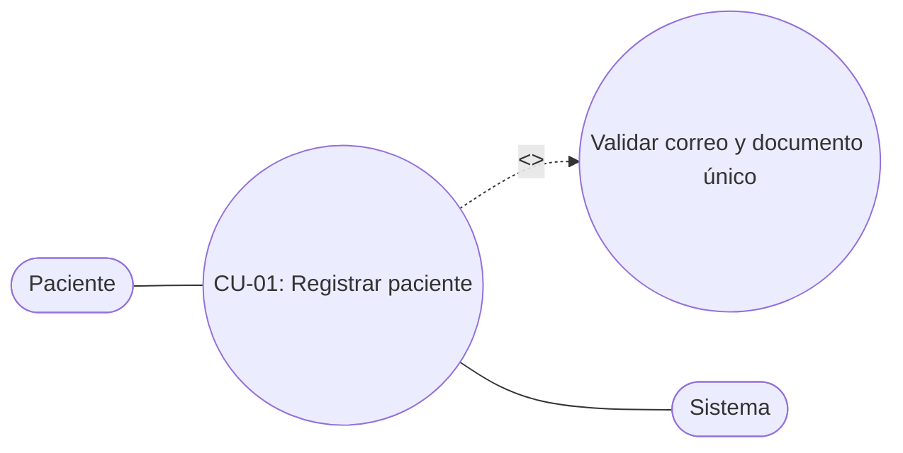

#### CU-02 — Iniciar sesión en la plataforma
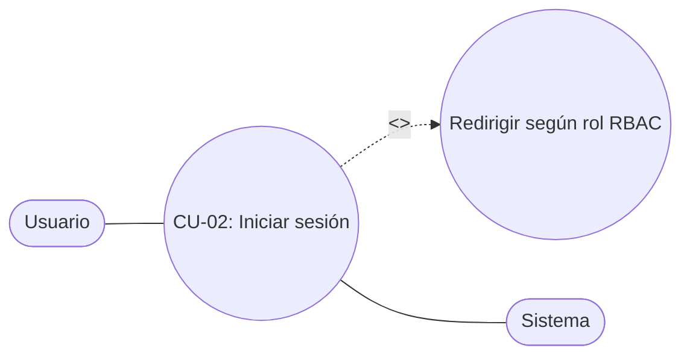

#### CU-03 — Cerrar sesión de forma segura
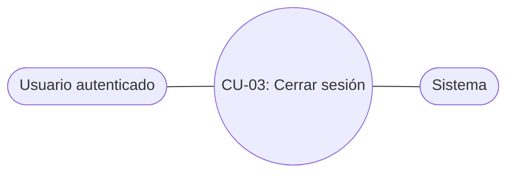

#### CU-04 — Consultar especialidades y directorio médico público
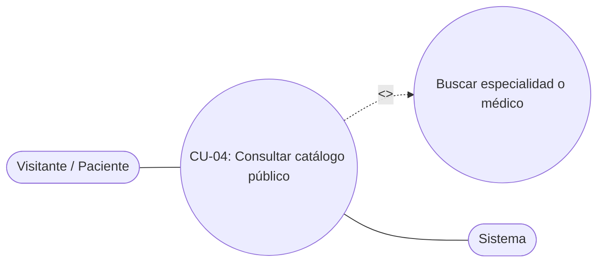

#### CU-05 — Usar selector rápido de sesión demo
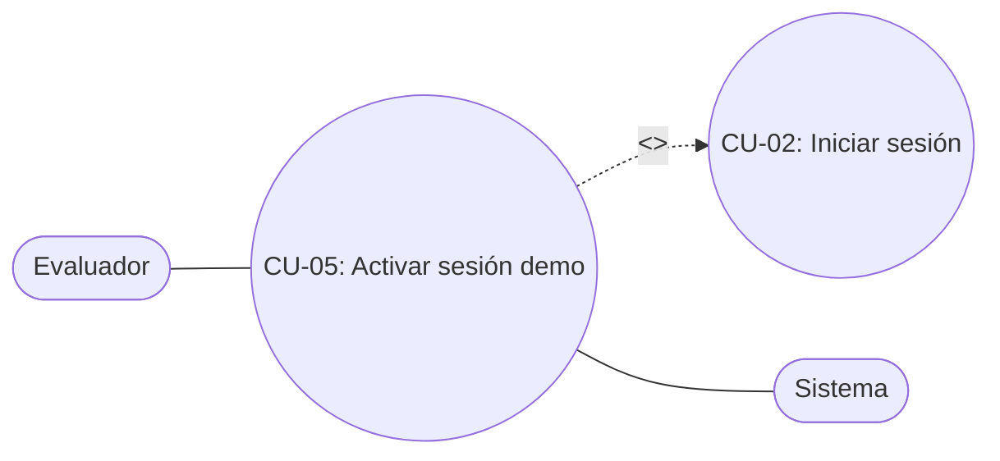

#### CU-06 — Registrar pacientes desde administración
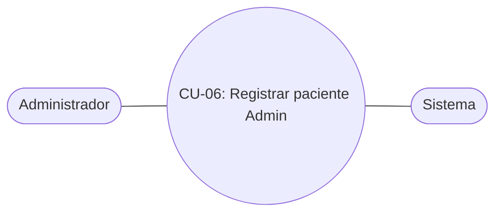

#### CU-07 — Consultar listado administrativo de pacientes
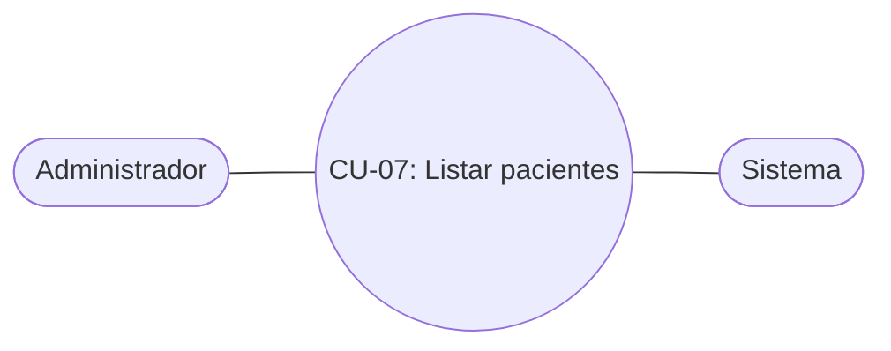

#### CU-08 — Crear y editar especialidades médicas
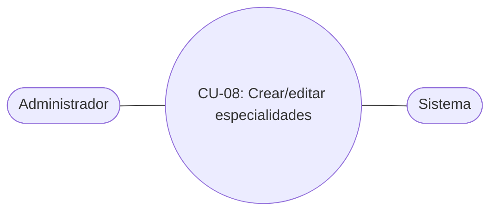

#### CU-09 — Activar o desactivar especialidades médicas
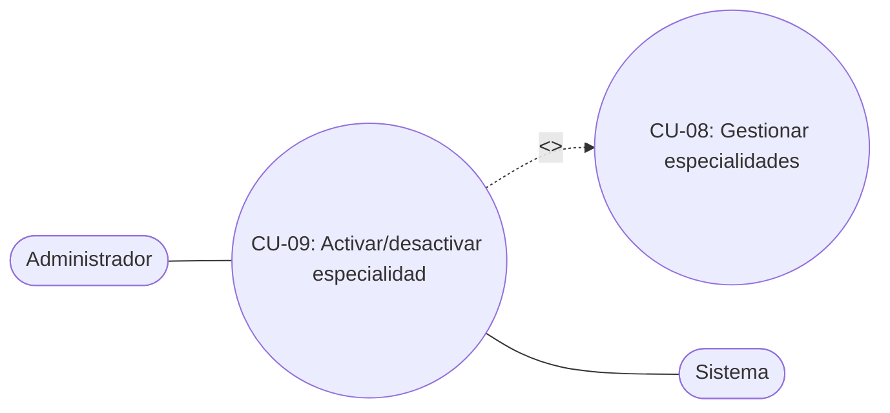

#### CU-10 — Registrar profesionales médicos con agenda inicial
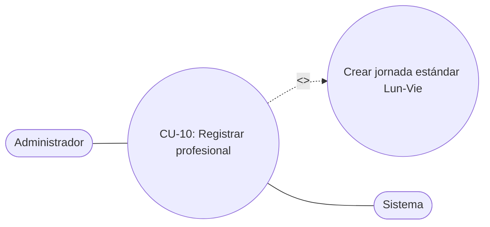

#### CU-11 — Activar o desactivar profesionales médicos
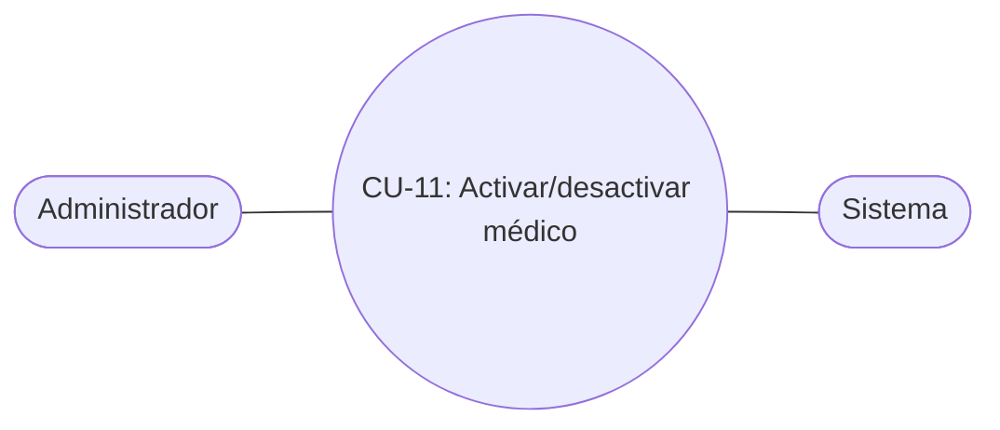

#### CU-12 — Configurar horarios de atención semanal sin superposición
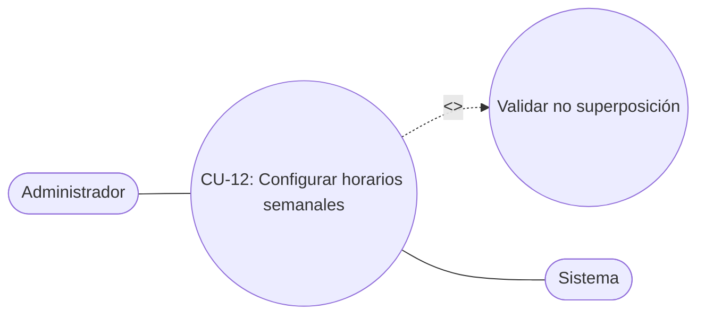

#### CU-13 — Registrar bloqueos de horario
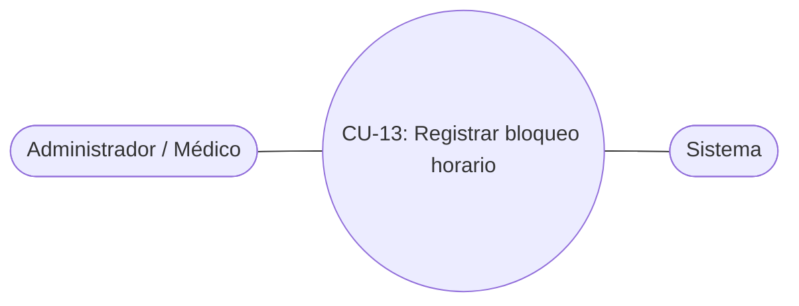

#### CU-14 — Generar calendario de fechas hábiles por profesional
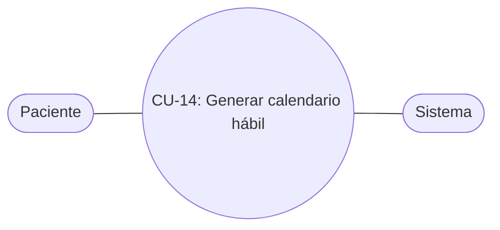

#### CU-15 — Consultar franjas horarias disponibles en tiempo real
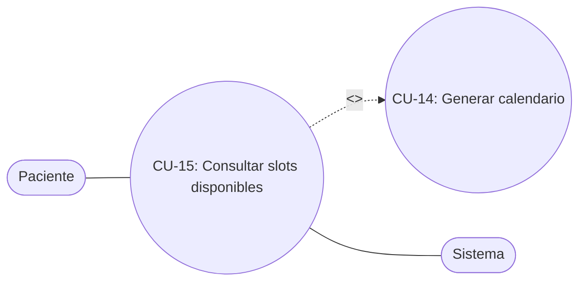

#### CU-16 — Reservar cita médica con prevención de solapamiento
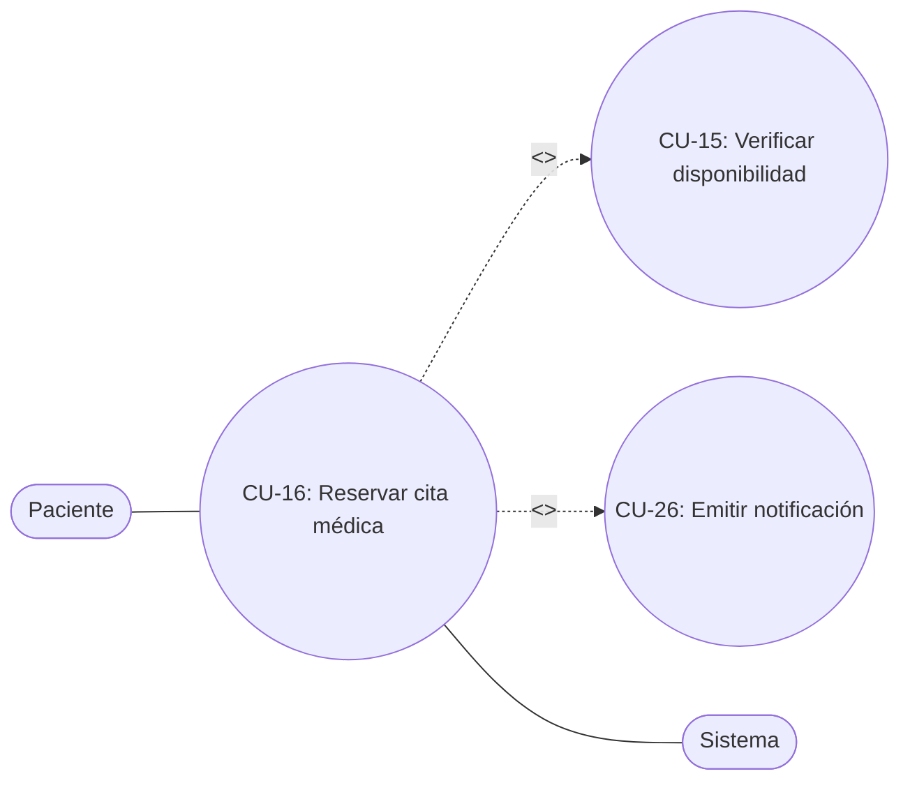

#### CU-17 — Emitir voucher de confirmación y enlace a WhatsApp Web
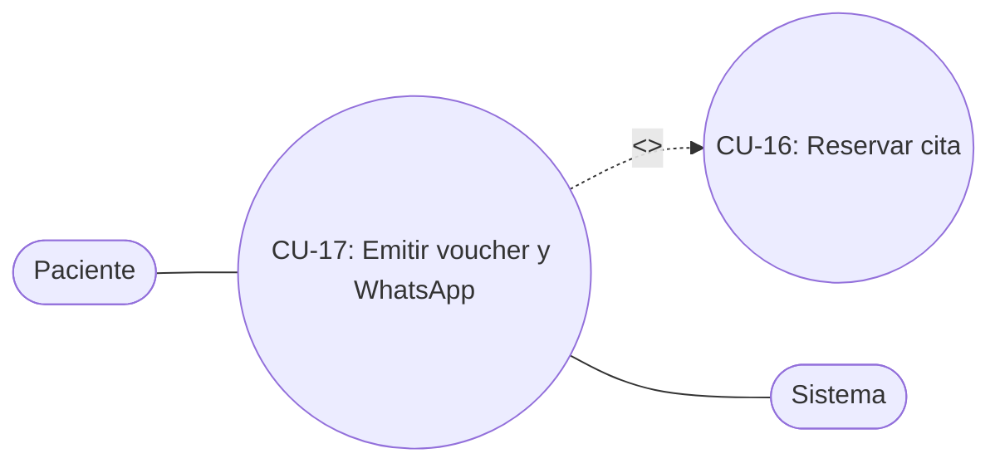

#### CU-18 — Simular conflicto de concurrencia (Error 409)
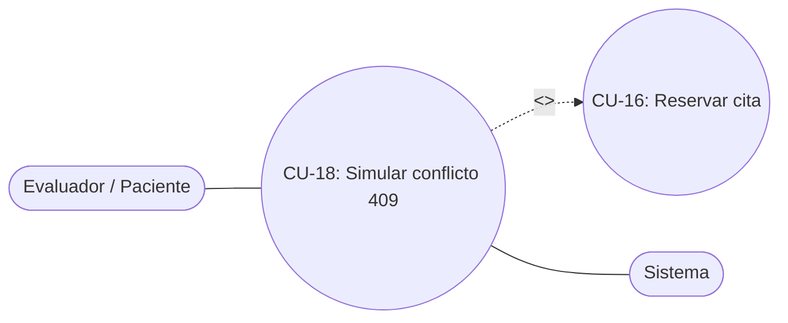

#### CU-19 — Consultar mis citas programadas e historial
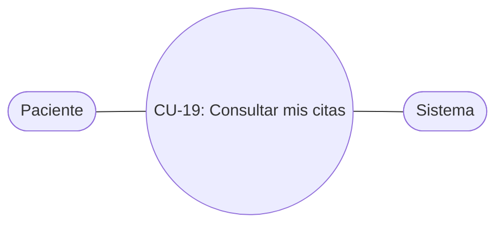

#### CU-20 — Cancelar cita médica con regla mínima de 2 horas
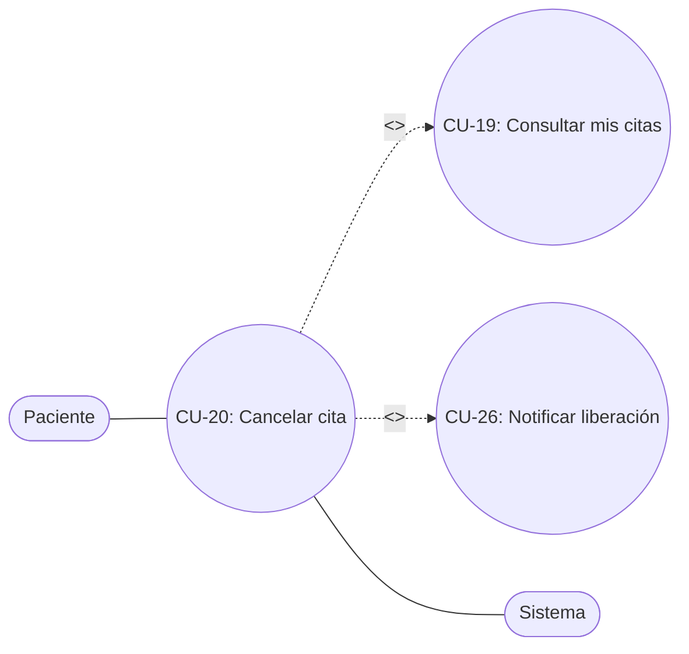

#### CU-21 — Reprogramar cita médica hacia un nuevo horario disponible
```mermaid
flowchart LR
  P([Paciente]) --- CU21((CU-21: Reprogramar cita))
  CU21 -. "<<extend>>" .-> CU19((CU-19: Consultar mis citas))
  CU21 -. "<<include>>" .-> CU15((CU-15: Consultar disponibilidad))
  CU21 --- S([Sistema])
```

#### CU-22 — Consultar agenda médica por fecha e historial
```mermaid
flowchart LR
  M([Profesional Médico]) --- CU22((CU-22: Consultar agenda médica))
  CU22 --- S([Sistema])
```

#### CU-23 — Actualizar estado de atención de la cita
```mermaid
flowchart LR
  M([Profesional Médico]) --- CU23((CU-23: Marcar Atendida / Inasistencia))
  CU23 -. "<<extend>>" .-> CU22((CU-22: Consultar agenda))
  CU23 -. "<<include>>" .-> CU26((CU-26: Notificar al paciente))
  CU23 --- S([Sistema])
```

#### CU-24 — Visualizar dashboard administrativo con indicadores clave
```mermaid
flowchart LR
  A([Administrador]) --- CU24((CU-24: Ver dashboard KPIs))
  CU24 --- S([Sistema])
```

#### CU-25 — Generar y exportar reportes filtrados de citas (CSV)
```mermaid
flowchart LR
  A([Administrador]) --- CU25((CU-25: Generar y exportar reportes))
  CU25 --- S([Sistema])
```

#### CU-26 — Consultar y marcar notificaciones internas del sistema
```mermaid
flowchart LR
  U([Usuario autenticado]) --- CU26((CU-26: Consultar notificaciones))
  CU26 --- S([Sistema])
```

---

### 3.3. Requerimientos Funcionales

A continuación, se detallan los 26 requerimientos funcionales del sistema, numerados de forma correlativa y correspondientes 1 a 1 con las Historias de Usuario (`RF ↔ HU`).

| **Identificador:** RF1 | **Nombre:** Registrar paciente | |
| :--- | :--- | :--- |
| **Tipo:** Necesario | **Requerimiento relacionado:** RF2 (Iniciar sesión) / RF6 (Registrar paciente Admin) | **¿Crítico?** Sí |
| **Prioridad de desarrollo:** Alta | **Documentos de visualización asociados:** `RegistroPage.jsx` / Formulario de registro | |
| **Entrada:**<br>• Nombre y apellido.<br>• Tipo y número de documento.<br>• Teléfono y fecha de nacimiento.<br>• Correo electrónico y contraseña.<br>• Aceptación de política de datos (Ley 1581). | **Salida:**<br>• Usuario creado en `users` (`rol = paciente`) y perfil en `pacientes`.<br>• Sesión iniciada vía cookie `HttpOnly`.<br>• Redirección a `/paciente/reservar`. | |
| **Descripción:** El sistema deberá permitir el registro público de pacientes validando unicidad de correo y número de documento, fecha de nacimiento anterior al día actual y longitud mínima de contraseña (8 caracteres). | | |
| **Manejo de situaciones anormales:**<br>• Campos inválidos o incompletos: resaltar borde rojo y mostrar mensaje descriptivo en línea.<br>• Correo o documento duplicado: retornar HTTP `422` e impedir el registro.<br>• Error de servidor: mostrar alerta sin perder datos ingresados. | | |
| **Criterios de aceptación:**<br>• El paciente se registra completando todos los campos obligatorios.<br>• No se permiten correos o documentos repetidos en MySQL.<br>• La contraseña se almacena cifrada con hashing seguro (`bcrypt`). | | |

| **Identificador:** RF2 | **Nombre:** Iniciar sesión con selección de perfil y protección contra fuerza bruta | |
| :--- | :--- | :--- |
| **Tipo:** Necesario | **Requerimiento relacionado:** RF1 (Registrar paciente) / RF3 (Cerrar sesión) | **¿Crítico?** Sí |
| **Prioridad de desarrollo:** Alta | **Documentos de visualización asociados:** `LoginPage.jsx` / `AuthController::login` / `EnsureUserHasRole` | |
| **Entrada:**<br>• Correo electrónico.<br>• Contraseña.<br>• Perfil seleccionado (`paciente`, `profesional`/`medico`, `administrador`). | **Salida:**<br>• Cookie `HttpOnly` cifrada de sesión Laravel.<br>• Objeto de usuario con rol normalizado.<br>• Redirección automática al panel correspondiente (`/paciente/citas`, `/medico/agenda` o `/admin/dashboard`). | |
| **Descripción:** El sistema deberá validar las credenciales ingresadas contra la tabla `users`, verificar que la cuenta esté activa, comprobar que el rol del usuario coincida con el perfil institucional seleccionado, y aplicar control de tasa contra ataques de fuerza bruta. | | |
| **Manejo de situaciones anormales:**<br>• Credenciales inválidas: retornar HTTP `401 Unauthorized` con mensaje de error.<br>• Discrepancia entre perfil seleccionado y rol real: retornar HTTP `403 Forbidden` prohibiendo el acceso cruzado.<br>• Ataque de fuerza bruta (5 fallos consecutivos): bloquear por 60 segundos y retornar HTTP `429 Too Many Requests` con cabecera `Retry-After`.<br>• Cuenta desactivada: retornar HTTP `403` impidiendo el ingreso. | | |
| **Criterios de aceptación:**<br>• Usuario válido accede exclusivamente al panel asignado a su perfil.<br>• Intentos cruzados de perfil son bloqueados con `403`.<br>• Quinto fallo consecutivo activa bloqueo temporal por 60s con `429`.<br>• Toda ruta protegida redirige a `/login` si no existe sesión válida. | | |

| **Identificador:** RF3 | **Nombre:** Cerrar sesión | |
| :--- | :--- | :--- |
| **Tipo:** Necesario | **Requerimiento relacionado:** RF2 (Iniciar sesión) | **¿Crítico?** Sí |
| **Prioridad de desarrollo:** Alta | **Documentos de visualización asociados:** `Navbar.jsx` / `AuthController::logout` | |
| **Entrada:**<br>• Solicitud de cierre de sesión del usuario autenticado. | **Salida:**<br>• Sesión invalidada y token regenerado en servidor.<br>• Redirección a `/login`. | |
| **Descripción:** El sistema deberá permitir cerrar la sesión activa desde la barra de navegación superior en escritorio y móvil, eliminando la sesión del servidor. | | |
| **Manejo de situaciones anormales:**<br>• Si la sesión ya expiró en servidor, limpiar igualmente el estado del cliente y redirigir a `/login`. | | |
| **Criterios de aceptación:**<br>• Al cerrar sesión, las peticiones posteriores a endpoints privados devuelven `401`.<br>• Se muestra toast informativo de cierre seguro. | | |

| **Identificador:** RF4 | **Nombre:** Consultar especialidades y directorio médico en agendamiento | |
| :--- | :--- | :--- |
| **Tipo:** Necesario | **Requerimiento relacionado:** RF14 (Calendario) / RF16 (Reservar cita) | **¿Crítico?** Sí |
| **Prioridad de desarrollo:** Alta | **Documentos de visualización asociados:** `ReservaPage.jsx` / `CatalogoController` | |
| **Entrada:**<br>• Término de búsqueda en buscador predictivo.<br>• Filtro por especialidad seleccionada. | **Salida:**<br>• Sugerencias predictivas de especialidades y médicos.<br>• Listado filtrado de profesionales activos con tarjeta profesional y consultorio. | |
| **Descripción:** El sistema deberá exponer en el flujo autenticado de reserva y administración el catálogo de especialidades y médicos activos, permitiendo al usuario filtrar y seleccionar el profesional adecuado. | | |
| **Manejo de situaciones anormales:**<br>• Sin coincidencias: mostrar mensaje amigable y botón para restablecer filtros. | | |
| **Criterios de aceptación:**<br>• Solo se muestran especialidades y profesionales activos.<br>• El buscador predictivo responde en tiempo real. | | |

| **Identificador:** RF5 | **Nombre:** Activar sesión demo para auditoría | |
| :--- | :--- | :--- |
| **Tipo:** Necesario | **Requerimiento relacionado:** RF2 (Iniciar sesión) | **¿Crítico?** No |
| **Prioridad de desarrollo:** Media | **Documentos de visualización asociados:** `Navbar.jsx` / `LoginPage.jsx` / `AuthController::demoLogin` | |
| **Entrada:**<br>• Selección de rol demo (`paciente`, `medico` o `admin`). | **Salida:**<br>• Sesión real emitida contra el usuario demo en MySQL.<br>• Navegación inmediata al panel correspondiente. | |
| **Descripción:** El sistema deberá ofrecer en la barra de navegación un selector rápido `[Paciente Demo | Médico Demo | Admin Demo]` para auditar cada perfil con datos reales de prueba. | | |
| **Manejo de situaciones anormales:**<br>• Si los seeders no han sido ejecutados, responder HTTP `404` indicando ejecutar seeders. | | |
| **Criterios de aceptación:**<br>• Cambia de sesión autenticada vía cookie `HttpOnly` sin exponer contraseñas en cliente. | | |

| **Identificador:** RF6 | **Nombre:** Registrar paciente desde administración | |
| :--- | :--- | :--- |
| **Tipo:** Necesario | **Requerimiento relacionado:** RF1 (Registro público) / RF7 (Listar pacientes) | **¿Crítico?** Sí |
| **Prioridad de desarrollo:** Alta | **Documentos de visualización asociados:** `ModalPacienteAdmin.jsx` / `CatalogoController::storePaciente` | |
| **Entrada:**<br>• Nombre, apellido, tipo/número de documento, teléfono, fecha de nacimiento y correo. | **Salida:**<br>• Registro creado en `users` y `pacientes` dentro de `DB::transaction`.<br>• Actualización del listado y métricas del dashboard. | |
| **Descripción:** El administrador podrá dar de alta nuevos pacientes directamente desde el panel administrativo. | | |
| **Manejo de situaciones anormales:**<br>• Usuario sin rol administrador: responder HTTP `403`.<br>• Documento o correo ya existente: responder HTTP `422`. | | |
| **Criterios de aceptación:**<br>• Solo el rol `administrador` puede ejecutar la operación.<br>• Valida unicidad e integridad referencial en MySQL. | | |

| **Identificador:** RF7 | **Nombre:** Consultar listado administrativo de pacientes | |
| :--- | :--- | :--- |
| **Tipo:** Necesario | **Requerimiento relacionado:** RF6 (Registrar paciente Admin) | **¿Crítico?** No |
| **Prioridad de desarrollo:** Media | **Documentos de visualización asociados:** `DashboardAdminPage.jsx` / `CatalogoController::pacientes` | |
| **Entrada:**<br>• Solicitud autenticada del administrador a `GET /api/pacientes`. | **Salida:**<br>• Tabla con nombre, correo, documento, teléfono, fecha de nacimiento y conteo de citas. | |
| **Descripción:** El sistema deberá permitir al administrador consultar todos los pacientes registrados en la base de datos. | | |
| **Manejo de situaciones anormales:**<br>• Acceso por rol `paciente` o `medico`: bloquear con HTTP `403`. | | |
| **Criterios de aceptación:**<br>• El conteo de citas por paciente refleja las reservas registradas en MySQL. | | |

| **Identificador:** RF8 | **Nombre:** Crear y editar especialidades médicas | |
| :--- | :--- | :--- |
| **Tipo:** Necesario | **Requerimiento relacionado:** RF9 (Activar/desactivar) / RF4 (Catálogo público) | **¿Crítico?** Sí |
| **Prioridad de desarrollo:** Alta | **Documentos de visualización asociados:** `ModalEspecialidadAdmin.jsx` / `CatalogoController` | |
| **Entrada:**<br>• Nombre único, descripción y duración promedio (15, 20, 30, 45 o 60 min). | **Salida:**<br>• Especialidad creada o actualizada en tabla `especialidades`. | |
| **Descripción:** El administrador podrá crear nuevas especialidades médicas y editar la información de las existentes. | | |
| **Manejo de situaciones anormales:**<br>• Nombre duplicado: rechazar con HTTP `422`.<br>• Rol no autorizado: rechazar con HTTP `403`. | | |
| **Criterios de aceptación:**<br>• Las nuevas especialidades quedan disponibles para asociar profesionales y consultar en catálogo. | | |

| **Identificador:** RF9 | **Nombre:** Activar o desactivar especialidades médicas | |
| :--- | :--- | :--- |
| **Tipo:** Necesario | **Requerimiento relacionado:** RF8 (Crear/editar especialidades) | **¿Crítico?** No |
| **Prioridad de desarrollo:** Media | **Documentos de visualización asociados:** `DashboardAdminPage.jsx` / `CatalogoController::toggleEspecialidad` | |
| **Entrada:**<br>• Identificador de la especialidad. | **Salida:**<br>• Campo `activa` invertido en MySQL y reflejado en UI. | |
| **Descripción:** El administrador podrá habilitar o inhabilitar especialidades sin perder integridad con citas históricas. | | |
| **Manejo de situaciones anormales:**<br>• Especialidad inexistente: retornar HTTP `404`. | | |
| **Criterios de aceptación:**<br>• Especialidades inactivas no se muestran en `GET /api/especialidades` público. | | |

| **Identificador:** RF10 | **Nombre:** Registrar profesionales médicos | |
| :--- | :--- | :--- |
| **Tipo:** Necesario | **Requerimiento relacionado:** RF8 (Especialidades) / RF12 (Horarios) | **¿Crítico?** Sí |
| **Prioridad de desarrollo:** Alta | **Documentos de visualización asociados:** `DashboardAdminPage.jsx` / `CatalogoController::storeMedico` | |
| **Entrada:**<br>• Nombre, correo institucional, tarjeta profesional, especialidad, consultorio y duración de cita. | **Salida:**<br>• Registros creados en `users`, `medicos`, `horarios_atencion` (Lun-Vie) y `notificaciones`. | |
| **Descripción:** El administrador podrá registrar nuevos médicos asociando su especialidad y generando automáticamente una plantilla inicial de horario semanal. | | |
| **Manejo de situaciones anormales:**<br>• Correo o tarjeta profesional duplicados: responder HTTP `422`.<br>• Usuario no administrador: responder HTTP `403`. | | |
| **Criterios de aceptación:**<br>• El profesional recién creado aparece inmediatamente en el directorio y calendario de reservas. | | |

| **Identificador:** RF11 | **Nombre:** Activar o desactivar profesionales médicos | |
| :--- | :--- | :--- |
| **Tipo:** Necesario | **Requerimiento relacionado:** RF10 (Registrar profesionales) | **¿Crítico?** Sí |
| **Prioridad de desarrollo:** Media | **Documentos de visualización asociados:** `DashboardAdminPage.jsx` / `CatalogoController::toggleMedico` | |
| **Entrada:**<br>• Identificador del médico. | **Salida:**<br>• Estado `activo` actualizado en `medicos` y `users`. | |
| **Descripción:** El administrador podrá suspender o reactivar la disponibilidad operativa de un médico en el sistema. | | |
| **Manejo de situaciones anormales:**<br>• Intento de reserva sobre médico inactivo: rechazar con HTTP `409`. | | |
| **Criterios de aceptación:**<br>• Un médico inactivo no se lista en la página pública ni recibe nuevas reservas. | | |

| **Identificador:** RF12 | **Nombre:** Configurar horarios de atención semanal | |
| :--- | :--- | :--- |
| **Tipo:** Necesario | **Requerimiento relacionado:** RF14 (Calendario) / RF15 (Slots) | **¿Crítico?** Sí |
| **Prioridad de desarrollo:** Alta | **Documentos de visualización asociados:** `ModalHorariosMedico.jsx` / `AgendaController` | |
| **Entrada:**<br>• Médico, día de la semana (1-7), hora inicio, hora fin y duración estándar de cita. | **Salida:**<br>• Franja horaria persistida en `horarios_atencion` (o eliminada si se solicita). | |
| **Descripción:** El administrador o el propio médico podrán configurar los bloques semanales de atención verificando que no exista superposición con bloques activos del mismo día. | | |
| **Manejo de situaciones anormales:**<br>• Hora fin menor o igual a hora inicio: rechazar con HTTP `422`.<br>• Superposición con otro horario del mismo día: rechazar con HTTP `409 Conflict`. | | |
| **Criterios de aceptación:**<br>• No se permiten bloques superpuestos en la base de datos.<br>• El cálculo de disponibilidad refleja de inmediato los cambios de horario. | | |

| **Identificador:** RF13 | **Nombre:** Registrar bloqueos de horario | |
| :--- | :--- | :--- |
| **Tipo:** Necesario | **Requerimiento relacionado:** RF15 (Disponibilidad) / RF16 (Reservar cita) | **¿Crítico?** No |
| **Prioridad de desarrollo:** Media | **Documentos de visualización asociados:** `AgendaController::crearBloqueo` | |
| **Entrada:**<br>• Médico, `fecha_hora_inicio`, `fecha_hora_fin`, tipo (`descanso`, `vacaciones`, `incapacidad`, `administrativo`) y motivo. | **Salida:**<br>• Registro en tabla `bloqueos_horario`. | |
| **Descripción:** El sistema deberá permitir registrar excepciones temporales que bloqueen franjas específicas de atención médica. | | |
| **Manejo de situaciones anormales:**<br>• Médico intentando bloquear agenda ajena: rechazar con HTTP `403`. | | |
| **Criterios de aceptación:**<br>• Las franjas cubiertas por un bloqueo aparecen no disponibles (`Bloqueado`) y no pueden reservarse. | | |

| **Identificador:** RF14 | **Nombre:** Generar calendario de días hábiles | |
| :--- | :--- | :--- |
| **Tipo:** Necesario | **Requerimiento relacionado:** RF12 (Horarios) / RF15 (Slots) | **¿Crítico?** Sí |
| **Prioridad de desarrollo:** Alta | **Documentos de visualización asociados:** `SelectorSlots.jsx` / `AgendaDisponibilidadService::generarCalendario` | |
| **Entrada:**<br>• Identificador del médico y cantidad de días hábiles a proyectar. | **Salida:**<br>• Arreglo de fechas hábiles (`iso`, `dayName`, `dayNum`, `monthShort`, `total_slots`, `slots_libres`). | |
| **Descripción:** El servicio de agendas deberá generar dinámicamente los próximos días hábiles de atención según la configuración semanal del profesional en MySQL. | | |
| **Manejo de situaciones anormales:**<br>• Médico sin jornadas activas: retornar calendario vacío con mensaje informativo. | | |
| **Criterios de aceptación:**<br>• Solo incluye días con al menos una jornada configurada.<br>• Indica correctamente cuántos cupos libres existen por día. | | |

| **Identificador:** RF15 | **Nombre:** Consultar franjas horarias disponibles | |
| :--- | :--- | :--- |
| **Tipo:** Necesario | **Requerimiento relacionado:** RF14 (Calendario) / RF16 (Reservar cita) | **¿Crítico?** Sí |
| **Prioridad de desarrollo:** Alta | **Documentos de visualización asociados:** `SelectorSlots.jsx` / `AgendaDisponibilidadService::obtenerSlotsDisponibles` | |
| **Entrada:**<br>• Identificador del médico y fecha en formato `YYYY-MM-DD`. | **Salida:**<br>• Lista ordenada de franjas con estado `libre` (`true`/`false`) y `motivo` (`Disponible`, `Ocupado`, `Bloqueado`, `Pasado`). | |
| **Descripción:** El sistema calculará en el servidor todas las franjas de la fecha según la duración configurada, descontando horas pasadas, bloqueos y citas en estado `programada` o `confirmada`. | | |
| **Manejo de situaciones anormales:**<br>• Fecha con formato inválido: rechazar con HTTP `422`.<br>• Día sin cupos libres: UI sugiere saltar al próximo día hábil con disponibilidad. | | |
| **Criterios de aceptación:**<br>• Ninguna franja pasada o reservada se muestra como disponible.<br>• Franjas de citas canceladas vuelven a quedar libres inmediatamente. | | |

| **Identificador:** RF16 | **Nombre:** Reservar cita médica (anti-solapamiento) | |
| :--- | :--- | :--- |
| **Tipo:** Necesario | **Requerimiento relacionado:** RF15 (Disponibilidad) / RF17 (Voucher) | **¿Crítico?** Sí |
| **Prioridad de desarrollo:** Alta | **Documentos de visualización asociados:** `ReservarCitaPage.jsx` / `CitaController::store` | |
| **Entrada:**<br>• `medico_id`, `especialidad_id`, `fecha_hora_inicio`, `fecha_hora_fin` y `motivo_consulta` (opcional). | **Salida:**<br>• Cita creada con `codigo_reserva` único (`MT-YYYYMM-XXXX`).<br>• Registro de auditoría en `historial_citas` y notificaciones para paciente y médico. | |
| **Descripción:** El sistema deberá registrar la cita dentro de una transacción `DB::transaction` usando bloqueo pesimista `lockForUpdate()` sobre el rango horario del médico para impedir reservas simultáneas. | | |
| **Manejo de situaciones anormales:**<br>• Fecha pasada (`<= now()`): responder HTTP `400`.<br>• Especialidad no corresponde al médico: responder HTTP `400`.<br>• Colisión concurrente o bloqueo de horario: responder HTTP `409 Conflict`. | | |
| **Criterios de aceptación:**<br>• Dos reservas simultáneas para el mismo médico y horario nunca se aprueban ambas: la segunda recibe `409 Conflict`.<br>• El paciente autenticado se toma del servidor, nunca de un parámetro libre del navegador. | | |

| **Identificador:** RF17 | **Nombre:** Emitir voucher y enlace dinámico a WhatsApp Web | |
| :--- | :--- | :--- |
| **Tipo:** Necesario | **Requerimiento relacionado:** RF16 (Reservar cita) | **¿Crítico?** No |
| **Prioridad de desarrollo:** Media | **Documentos de visualización asociados:** `VoucherConfirmacion.jsx` | |
| **Entrada:**<br>• Objeto de cita recién creada (`201 Created`). | **Salida:**<br>• Tarjeta de confirmación con código único, datos de la cita, botón `window.print()` y URI `https://wa.me/...`. | |
| **Descripción:** Tras completar una reserva, la interfaz mostrará el comprobante oficial con botón verde esmeralda hacia WhatsApp Web precargando los datos de la cita. | | |
| **Manejo de situaciones anormales:**<br>• Datos opcionales vacíos (ej. motivo): mostrar texto estándar sin romper el formato del enlace. | | |
| **Criterios de aceptación:**<br>• El código de reserva y los datos mostrados coinciden con los almacenados en MySQL. | | |

| **Identificador:** RF18 | **Nombre:** Simular conflicto de concurrencia (Error 409) | |
| :--- | :--- | :--- |
| **Tipo:** Opcional | **Requerimiento relacionado:** RF16 (Reservar cita) | **¿Crítico?** No |
| **Prioridad de desarrollo:** Baja | **Documentos de visualización asociados:** `ReservarCitaPage.jsx` / `CitaController::store` | |
| **Entrada:**<br>• Bandera `simular_conflicto = true` activada en el interruptor de prueba. | **Salida:**<br>• Respuesta HTTP `409` *"El turno seleccionado acaba de ser tomado por otro paciente"*.<br>• Toast de alerta y recarga reactiva de slots. | |
| **Descripción:** Permite demostrar en vivo el comportamiento de recuperación de la interfaz ante una condición de carrera sin reiniciar la selección de médico. | | |
| **Manejo de situaciones anormales:**<br>• Desactiva automáticamente el interruptor tras disparar el conflicto para permitir completar el siguiente intento. | | |
| **Criterios de aceptación:**<br>• La pantalla refresca la disponibilidad sin recargar el navegador. | | |

| **Identificador:** RF19 | **Nombre:** Consultar mis citas (Paciente) | |
| :--- | :--- | :--- |
| **Tipo:** Necesario | **Requerimiento relacionado:** RF20 (Cancelar) / RF21 (Reprogramar) | **¿Crítico?** Sí |
| **Prioridad de desarrollo:** Alta | **Documentos de visualización asociados:** `MisCitasPage.jsx` / `CitaController::index` | |
| **Entrada:**<br>• Sesión autenticada de paciente. | **Salida:**<br>• Listado separado en pestañas **Programadas** (`programada`, `confirmada`) e **Historial** (`completada`, `cancelada`, `no_asistio`). | |
| **Descripción:** El paciente podrá visualizar exclusivamente sus propias citas con código, profesional, especialidad, consultorio, estado semántico y acciones permitidas. | | |
| **Manejo de situaciones anormales:**<br>• Sin registros en la pestaña: renderizar `EmptyState.jsx` con botón *"Agendar mi primera cita"*. | | |
| **Criterios de aceptación:**<br>• Un paciente nunca recibe citas pertenecientes a otro paciente. | | |

| **Identificador:** RF20 | **Nombre:** Cancelar cita médica (regla de 2 horas) | |
| :--- | :--- | :--- |
| **Tipo:** Necesario | **Requerimiento relacionado:** RF19 (Mis citas) / RF15 (Disponibilidad) | **¿Crítico?** Sí |
| **Prioridad de desarrollo:** Alta | **Documentos de visualización asociados:** `ModalCancelar.jsx` / `CitaController::cancelar` | |
| **Entrada:**<br>• Identificador de la cita y motivo opcional de cancelación. | **Salida:**<br>• Cita actualizada a `cancelada`, registro en `historial_citas`, notificación y liberación inmediata del horario. | |
| **Descripción:** El paciente puede cancelar una cita programada o confirmada siempre que falten al menos 2 horas (120 minutos) para su inicio. | | |
| **Manejo de situaciones anormales:**<br>• Anticipación $< 2\text{ horas}$: botón deshabilitado en UI con tooltip *"Límite superado: mínimo 2 horas de anticipación"* y rechazo HTTP `400` en servidor.<br>• Cita de otro paciente: rechazar con HTTP `403`. | | |
| **Criterios de aceptación:**<br>• La franja cancelada queda inmediatamente disponible para nuevas reservas. | | |

| **Identificador:** RF21 | **Nombre:** Reprogramar cita médica | |
| :--- | :--- | :--- |
| **Tipo:** Necesario | **Requerimiento relacionado:** RF15 (Disponibilidad) / RF19 (Mis citas) | **¿Crítico?** Sí |
| **Prioridad de desarrollo:** Media | **Documentos de visualización asociados:** `ModalReprogramar.jsx` / `CitaController::reprogramar` | |
| **Entrada:**<br>• Identificador de la cita, nueva `fecha_hora_inicio` y `fecha_hora_fin`. | **Salida:**<br>• Fecha y hora actualizadas en `citas`, registro del cambio en `historial_citas` y notificación al paciente. | |
| **Descripción:** El paciente podrá cambiar la fecha y hora de una cita futura ($\ge 2\text{ horas}$ de anticipación) hacia un nuevo slot disponible del mismo profesional dentro de una transacción `lockForUpdate()`. | | |
| **Manejo de situaciones anormales:**<br>• Menos de 2 horas para la cita original o nueva fecha pasada: rechazar con HTTP `400`.<br>• Nuevo horario ocupado o bloqueado: rechazar con HTTP `409 Conflict`.<br>• Cita ajena: rechazar con HTTP `403`. | | |
| **Criterios de aceptación:**<br>• El horario anterior queda libre y el nuevo horario queda reservado atómicamente. | | |

| **Identificador:** RF22 | **Nombre:** Consultar agenda médica por fecha e historial | |
| :--- | :--- | :--- |
| **Tipo:** Necesario | **Requerimiento relacionado:** RF23 (Actualizar estado) | **¿Crítico?** Sí |
| **Prioridad de desarrollo:** Alta | **Documentos de visualización asociados:** `AgendaMedicoPage.jsx` / `CitaController::index` | |
| **Entrada:**<br>• Sesión autenticada de médico y filtro seleccionado (`Hoy`, fecha específica o `Historial Completo`). | **Salida:**<br>• Listado cronológico de citas del médico con resumen numérico de turnos. | |
| **Descripción:** El profesional médico visualizará únicamente los turnos asignados a su agenda, junto con el documento, teléfono y motivo de consulta de cada paciente. | | |
| **Manejo de situaciones anormales:**<br>• Día sin turnos asignados: mostrar estado vacío con acceso al historial completo. | | |
| **Criterios de aceptación:**<br>• El médico no puede consultar agendas de otros profesionales. | | |

| **Identificador:** RF23 | **Nombre:** Actualizar estado de atención de la cita | |
| :--- | :--- | :--- |
| **Tipo:** Necesario | **Requerimiento relacionado:** RF22 (Agenda médica) | **¿Crítico?** Sí |
| **Prioridad de desarrollo:** Alta | **Documentos de visualización asociados:** `AgendaMedicoPage.jsx` / `CitaController::actualizarEstado` | |
| **Entrada:**<br>• Identificador de la cita y nuevo estado (`completada` o `no_asistio`). | **Salida:**<br>• Cita actualizada a estado final inmutable, registro en `historial_citas` y notificación al paciente. | |
| **Descripción:** El profesional médico podrá marcar cada consulta como atendida o registrar inasistencia al finalizar el turno. | | |
| **Manejo de situaciones anormales:**<br>• Intento de modificar una cita ya cerrada (`completada`, `no_asistio` o `cancelada`): rechazar con HTTP `400`.<br>• Médico intentando modificar cita de otro colega: rechazar con HTTP `403`. | | |
| **Criterios de aceptación:**<br>• Una cita completada bloquea los botones de edición en interfaz y API. | | |

| **Identificador:** RF24 | **Nombre:** Visualizar dashboard administrativo con KPIs | |
| :--- | :--- | :--- |
| **Tipo:** Necesario | **Requerimiento relacionado:** RF25 (Reportes) | **¿Crítico?** No |
| **Prioridad de desarrollo:** Media | **Documentos de visualización asociados:** `DashboardAdminPage.jsx` / `CitaController::index` | |
| **Entrada:**<br>• Sesión autenticada de administrador. | **Salida:**<br>• Indicadores: Total Pacientes, Médicos Activos, Citas Agendadas, Citas Atendidas y Citas Canceladas. | |
| **Descripción:** El panel administrativo presentará métricas globales actualizadas directamente desde la base de datos MySQL. | | |
| **Manejo de situaciones anormales:**<br>• Acceso por rol distinto a `administrador`: bloquear con vista Error `403`. | | |
| **Criterios de aceptación:**<br>• Las cifras se recalculan automáticamente tras crear médicos, pacientes o actualizar citas. | | |

| **Identificador:** RF25 | **Nombre:** Generar y exportar reportes filtrados de citas | |
| :--- | :--- | :--- |
| **Tipo:** Necesario | **Requerimiento relacionado:** RF24 (Dashboard) | **¿Crítico?** No |
| **Prioridad de desarrollo:** Media | **Documentos de visualización asociados:** `DashboardAdminPage.jsx` / `CitaController::reportes` | |
| **Entrada:**<br>• Filtros opcionales: `fecha_desde`, `fecha_hasta`, `medico_id`, `estado`. | **Salida:**<br>• Resumen numérico por estado, tabla de citas filtradas y descarga de archivo `.csv`. | |
| **Descripción:** El administrador podrá consultar reportes detallados combinando fechas, profesional y estado, y exportarlos en formato CSV. | | |
| **Manejo de situaciones anormales:**<br>• Sin coincidencias: mostrar resumen en ceros y mensaje de tabla vacía; deshabilitar exportación CSV. | | |
| **Criterios de aceptación:**<br>• Los totales coinciden con los registros devueltos por MySQL. | | |

| **Identificador:** RF26 | **Nombre:** Consultar y marcar notificaciones internas | |
| :--- | :--- | :--- |
| **Tipo:** Necesario | **Requerimiento relacionado:** RF16 / RF20 / RF21 / RF23 | **¿Crítico?** No |
| **Prioridad de desarrollo:** Media | **Documentos de visualización asociados:** `Navbar.jsx` / `NotificacionController` | |
| **Entrada:**<br>• Sesión autenticada del usuario. | **Salida:**<br>• Listado de notificaciones recientes y actualización de estado `leida = true`. | |
| **Descripción:** El sistema almacenará avisos internos ante eventos de reserva, cancelación, reprogramación o atención, mostrándolos en la campana del encabezado. | | |
| **Manejo de situaciones anormales:**<br>• Usuario sin notificaciones: mostrar bandeja vacía sin errores. | | |
| **Criterios de aceptación:**<br>• El contador rojo/verde de no leídas disminuye a cero al abrir la bandeja. | | |

---

### 3.4. Requerimientos no Funcionales

| **MediTurno** | | |
| :--- | :--- | :--- |
| **Código:** RNF-01 | **Nombre:** Velocidad de carga y respuesta | **Grado de necesidad:** Alta |
| **Descripción:** Rendimiento óptimo de carga de vistas y consulta de disponibilidad. | | |
| **Detalle:** El sistema deberá renderizar las vistas principales y responder a las consultas de calendarios y slots disponibles en un tiempo menor a 3 segundos bajo condiciones normales de red y prueba. | | |
| **Efecto Colateral:** Requiere índices compuestos en MySQL (`idx_cita_disponibilidad`, `idx_bloqueo_medico_rango`) y compilación optimizada con Vite. | | |

| **MediTurno** | | |
| :--- | :--- | :--- |
| **Código:** RNF-02 | **Nombre:** Usabilidad | **Grado de necesidad:** Alta |
| **Descripción:** Facilidad de uso e interacción intuitiva para pacientes, médicos y administradores. | | |
| **Detalle:** La interfaz seguirá una jerarquía visual 60-30-10 clara, validaciones en línea por campo, esqueletos de carga (`SkeletonLoader`) y estados vacíos orientados a la acción (`EmptyState`), permitiendo reservar una cita en menos de 3 minutos. | | |
| **Efecto Colateral:** Requiere pruebas de usabilidad con usuarios piloto y diseño guiado paso a paso. | | |

| **MediTurno** | | |
| :--- | :--- | :--- |
| **Código:** RNF-03 | **Nombre:** Seguridad de autenticación, sesiones y protección contra fuerza bruta | **Grado de necesidad:** Alta |
| **Descripción:** Protección de credenciales, mitigación de ataques de fuerza bruta y prevención de robo de sesión. | | |
| **Detalle:** Las contraseñas se almacenarán cifradas con algoritmo `bcrypt` (`cost 12`). Las sesiones se gestionarán mediante cookies `HttpOnly` cifradas transportadas con `credentials: 'include'` y protección CSRF. La arquitectura opera como Gatekeeper inicial estricto (ningún dato o catálogo es accesible sin autenticación previa). La API implementa limitador de tasa (`RateLimiter`) que tras 5 intentos fallidos bloquea la IP por 60 segundos con respuesta HTTP `429 Too Many Requests` y cabecera `Retry-After`. | | |
| **Efecto Colateral:** Requiere sincronización del temporizador de bloqueo en la interfaz de usuario y manejo del código HTTP `429`. | | |

| **MediTurno** | | |
| :--- | :--- | :--- |
| **Código:** RNF-04 | **Nombre:** Autorización estricta por roles (RBAC) y aislamiento de perfiles | **Grado de necesidad:** Alta |
| **Descripción:** Aislamiento total de datos y operaciones entre la tríada de perfiles (**Pacientes**, **Profesionales Médicos**, **Administrador**). | | |
| **Detalle:** Cada endpoint del backend está protegido por el middleware `EnsureUserHasRole` (`role:administrador,profesional,paciente`) y cada ruta de cliente por el componente `ProtectedRoute`. Se prohíbe el cruce de perfiles (un paciente no puede ingresar por la pestaña de profesional ni un profesional como administrador, respondiendo HTTP `403 Forbidden`). Asimismo, un paciente solo puede consultar o modificar sus propias citas y un médico únicamente su agenda asignada. | | |
| **Efecto Colateral:** Requiere verificación de propiedad de recursos en controladores además de las guardas visuales en React. | | |

| **MediTurno** | | |
| :--- | :--- | :--- |
| **Código:** RNF-05 | **Nombre:** Integridad de datos y control de concurrencia | **Grado de necesidad:** Alta |
| **Descripción:** Prevención total de citas duplicadas o solapadas. | | |
| **Detalle:** Toda reserva y reprogramación deberá ejecutarse en el servidor dentro de una transacción ACID en MySQL con bloqueo pesimista (`lockForUpdate()`), rechazando colisiones simultáneas con código HTTP `409 Conflict`. | | |
| **Efecto Colateral:** Mayor rigor transaccional en repositorios/controladores y manejo explícito del error `409` en la interfaz. | | |

| **MediTurno** | | |
| :--- | :--- | :--- |
| **Código:** RNF-06 | **Nombre:** Disponibilidad | **Grado de necesidad:** Alta |
| **Descripción:** Acceso continuo al sistema durante pruebas y operación. | | |
| **Detalle:** El sistema deberá ofrecer un endpoint `/api/health` verificable y apuntar a una disponibilidad mínima del 99% en entorno de pruebas programadas. | | |
| **Efecto Colateral:** Requiere monitoreo básico de conectividad entre Laravel y MySQL. | | |

| **MediTurno** | | |
| :--- | :--- | :--- |
| **Código:** RNF-07 | **Nombre:** Compatibilidad | **Grado de necesidad:** Alta |
| **Descripción:** Funcionamiento uniforme en navegadores web modernos. | | |
| **Detalle:** La aplicación web deberá funcionar correctamente en versiones vigentes de Google Chrome, Mozilla Firefox y Microsoft Edge. | | |
| **Efecto Colateral:** Requiere pruebas cruzadas en distintos navegadores antes de pasar a rama `QA` y `main`. | | |

| **MediTurno** | | |
| :--- | :--- | :--- |
| **Código:** RNF-08 | **Nombre:** Adaptabilidad (Diseño Responsivo) | **Grado de necesidad:** Alta |
| **Descripción:** Ajuste visual automático a escritorio, tableta y móvil. | | |
| **Detalle:** Todas las pantallas (Landing, Reserva, Mis Citas, Agenda Médica y Dashboard Admin) deberán adaptarse sin desbordamientos horizontales desde resoluciones móviles (375 px) hasta escritorio. | | |
| **Efecto Colateral:** Uso sistemático de rejillas responsivas Tailwind (`sm:`, `md:`, `lg:`) y tablas con desplazamiento horizontal controlado. | | |

| **MediTurno** | | |
| :--- | :--- | :--- |
| **Código:** RNF-09 | **Nombre:** Mantenibilidad | **Grado de necesidad:** Media |
| **Descripción:** Código modular, organizado por capas y documentado. | | |
| **Detalle:** El backend se separa en Modelos, Controladores API, Servicios (`AgendaDisponibilidadService`), Migraciones y Pruebas; el frontend se organiza en Contextos, Servicios HTTP, Componentes reutilizables y Páginas por rol. | | |
| **Efecto Colateral:** Requiere disciplina en revisiones de código y control de versiones por ramas (`DEV` → `QA` → `main`). | | |

| **MediTurno** | | |
| :--- | :--- | :--- |
| **Código:** RNF-10 | **Nombre:** Escalabilidad | **Grado de necesidad:** Media |
| **Descripción:** Capacidad de incorporar nuevos módulos en futuras fases. | | |
| **Detalle:** La arquitectura cliente-servidor API REST y el esquema relacional normalizado en MySQL deberán permitir agregar futuros módulos (recordatorios SMTP, múltiples sedes, exportación PDF) sin reescribir el núcleo transaccional. | | |
| **Efecto Colateral:** Diseño desacoplado de rutas `/api/*` y separación de lógica de negocio en clases `Services`. | | |

| **MediTurno** | | |
| :--- | :--- | :--- |
| **Código:** RNF-11 | **Nombre:** Privacidad y protección de datos personales | **Grado de necesidad:** Alta |
| **Descripción:** Cumplimiento de principios de la Ley 1581 de 2012 (Colombia). | | |
| **Detalle:** Los formularios de registro solicitan autorización explícita para tratamiento de datos, el pie de página declara el cumplimiento normativo y no se exponen contraseñas, tokens ni datos sensibles en logs o respuestas JSON. En entornos académicos solo se usan datos ficticios. | | |
| **Efecto Colateral:** Uso de campos ocultos (`$hidden`) en modelos Eloquent y sanitización de salidas. | | |

| **MediTurno** | | |
| :--- | :--- | :--- |
| **Código:** RNF-12 | **Nombre:** Trazabilidad y auditoría | **Grado de necesidad:** Media |
| **Descripción:** Registro histórico de cambios de estado en las citas. | | |
| **Detalle:** Toda creación, cancelación, reprogramación o actualización clínica de estado de una cita deberá registrar un evento en `historial_citas` indicando `estado_anterior`, `estado_nuevo`, `usuario_responsable_id` y marca temporal. | | |
| **Efecto Colateral:** Incremento controlado de registros de auditoría vinculados mediante llave foránea con la tabla `citas`. | | |

---

## 4. Plan de Pruebas y Matriz de Trazabilidad

Las pruebas funcionales y de seguridad del sistema están automatizadas mediante **PHPUnit** sobre la base de datos de pruebas `mediturno_test` en MySQL (`backend/tests/Feature/PlanPruebasMvpTest.php`, `AgendaDisponibilidadTest.php`, `CitaTransaccionalTest.php` y `SeguridadAutenticacionTest.php`), verificando los 19 casos de prueba críticos del proyecto (`CP-01` a `CP-19`):

| Código | Caso de Prueba | Requerimiento Asociado | Resultado Esperado | Estado |
| :---: | :--- | :---: | :--- | :---: |
| **CP-01** | Registrar un paciente válido | `RF1` / `HU-01` | Paciente creado (`201`) en `users` y `pacientes` | Verificado |
| **CP-02** | Registrar un correo duplicado | `RF1` / `HU-01` | Sistema rechaza el registro (`422`) | Verificado |
| **CP-03** | Iniciar sesión correctamente | `RF2` / `HU-02` | Acceso autorizado (`200`) y sesión activa | Verificado |
| **CP-04** | Iniciar sesión con contraseña incorrecta | `RF2` / `HU-02` | Acceso rechazado (`401`) | Verificado |
| **CP-05** | Consultar profesionales activos | `RF4` / `HU-04` | Listado de profesionales disponible (`200`) | Verificado |
| **CP-06** | Consultar horarios disponibles y bloqueos | `RF14` / `RF15` | Muestra franjas disponibles y descuenta ocupadas/bloqueadas | Verificado |
| **CP-07** | Reservar una cita disponible | `RF16` / `HU-16` | Cita creada (`201`) con código único `MT-...` | Verificado |
| **CP-08** | Reservar horario ocupado (concurrencia) | `RF16` / `HU-16` | Operación rechazada (`409 Conflict`) | Verificado |
| **CP-09** | Reservar una cita en fecha/hora pasada | `RF16` / `RN-02` | Operación rechazada (`400 Bad Request`) | Verificado |
| **CP-10** | Cancelar una cita ($\ge 2\text{ h}$ y bloqueo $< 2\text{ h}$) | `RF20` / `HU-20` | Cancela y libera slot si $\ge 2\text{ h}$; rechaza `400` si $< 2\text{ h}$ | Verificado |
| **CP-11** | Consultar agenda médica del profesional | `RF22` / `HU-22` | Muestra citas asignadas al médico autenticado | Verificado |
| **CP-12** | Acceder o modificar cita de otro paciente | `RNF-04` / `RF20` | Acceso denegado (`403 Forbidden`) | Verificado |
| **CP-13** | Consultar reportes administrativos filtrados | `RF25` / `HU-25` | Retorna resumen y listado filtrado correcto (`200`) | Verificado |
| **CP-14** | Reprogramar una cita hacia horario libre | `RF21` / `HU-21` | Fecha/hora actualizadas y trazabilidad en `historial_citas` | Verificado |
| **CP-15** | Autenticación válida con selección de perfil para Pacientes, Profesionales y Administrador | `RF2` / `HU-02` | Acceso concedido (`200`) con rol verificado | Verificado |
| **CP-16** | Rechazo por cruce de perfiles no autorizados (ej. paciente intentando perfil profesional) | `RF2` / `RNF-04` | Acceso denegado (`403 Forbidden`) | Verificado |
| **CP-17** | Bloqueo temporal por fuerza bruta tras 5 intentos fallidos consecutivos | `RNF-02` / `RF2` | Bloqueo temporal activado (`429 Too Many Requests` + cabecera `Retry-After`) | Verificado |
| **CP-18** | Segregación estricta de privilegios por perfil en backend (middleware `EnsureUserHasRole`) | `RNF-04` | Denegación `403` a rutas fuera del alcance del perfil | Verificado |
| **CP-19** | Cierre de sesión seguro con destrucción de sesión e invalidación de token | `RNF-02` | Sesión destruida (`200`) y rechazo subsiguiente `401` | Verificado |
